# Plan de sprints de la fase 1

Última revisión: 2026-11-26.

Cómo se reparte el trabajo de la fase 1 (MVP público) en sprints de dos semanas, sin fechas. Es el entregable del paso 12 de la planificación y cierra la fase 0. Las historias están en [historias de la fase 1](../02-requisitos/historias-fase-1.md); las tareas técnicas, que no son historias, se crean como issues con la plantilla de tarea técnica.

## Capacidad

- Dedicación: de 5 a 10 horas por semana, es decir, de 10 a 20 horas por sprint.
- Estimación inicial: **1 punto ≈ 1,5 horas**, así que caben **de 7 a 13 puntos por sprint**; el plan apunta a la parte alta y se recorta si no da tiempo.
- **Desde el cierre del sprint 2 se planifica por velocidad**: cada sprint lleva como mucho los puntos terminados en el anterior (ahora 13: los sprints 0, 1, 2, 3 y 4 terminaron completos con 8, 13, 13, 12 y 13 puntos). Un sprint que termina todo lo planificado no baja la velocidad aunque llevara menos puntos: el sprint 3 llevaba 12 porque no cabía otra historia sin pasar de 13. La equivalencia de 1,5 horas por punto queda solo como referencia para el trabajo sin ayuda: el sprint 2 se hizo en unas 1,5 horas de reloj, así que convertir puntos en horas no sirve para planificar. Si un sprint no termina sus puntos, el siguiente lleva menos.
- Total de la fase: 21 historias y 15 tareas técnicas, **124 puntos** en 11 sprints.

## Sprints

| Sprint | Objetivo | Trabajo | Puntos |
| --- | --- | --- | --- |
| Sprint 0 | **Herramientas de calidad y datos de ejemplo.** Cierra la fase 0: formato y cobertura automáticos y los datos para la demo. | #83 Spotless y Checkstyle en el backend (2) #84 Husky y lint-staged (pre-commit) (2) #85 JaCoCo y cobertura en la CI (1) #86 Datos de ejemplo e imágenes libres (3) | 8 |
| Sprint 1 | **Bases del backend y del frontend.** Esqueleto de todo lo demás y la primera pantalla de configuración. | #87 Base del backend: errores, auditoría y tests de integración (3) #88 Base del frontend: tokens, fuentes, layout y navegación (3) #89 Proxy de /api en el SSR y configuración por entorno (3) #91 Actuator y despertar de la API desde el SSR (1) #59 Temporadas, categorías e instalaciones (3) | 13 |
| Sprint 2 | **Login y sesión.** El administrador entra, trabaja sin perder la sesión y la cierra. | #53 Iniciar sesión (5) #54 Mantener y cerrar la sesión (8) | 13 |
| Sprint 3 | **Personas y equipos.** Seguridad del login y alta de la estructura del club. | #55 Bloquear intentos repetidos de login (3) #60 Gestionar personas (3) #61 Gestionar equipos y plantillas (5) #90 Swagger con springdoc (1) | 12 |
| Sprint 4 | **Competiciones, partidos y resultados.** Todo el calendario y la clasificación se gestionan desde el panel. | #62 Gestionar competiciones y jornadas (3) #63 Gestionar partidos (5) #64 Introducir el marcador de sets (2) #65 Editar la clasificación a mano (3) | 13 |
| Sprint 5 | **Noticias e imágenes.** Publicar noticias con imagen y comprobar cada despliegue. | #56 Gestionar noticias (5) #58 Subir imágenes (5) #92 Smoke tras desplegar (2) | 12 |
| Sprint 6 | **Editor y portada.** Editor Markdown y la primera pantalla pública. | #57 Editor Markdown de noticias (5) #45 Portada con lo último del club (5) #46 Listado de noticias (3) | 13 |
| Sprint 7 | **Noticia, equipos y calendario públicos.** La web pública casi completa. | #47 Detalle de noticia (3) #48 Equipos y su plantilla (5) #49 Calendario de partidos (5) | 13 |
| Sprint 8 | **Clasificación, club y pruebas de la release.** Web pública completa y E2E. | #50 Clasificación y resultados (5) #51 Páginas del club (2) #52 Páginas legales (2) #93 Playwright y E2E de la release (3) | 12 |
| Sprint 9 | **Despliegue.** La web online en Render y TiDB, con despliegue seguro. | #94 Primer despliegue en Render y TiDB Cloud Starter (5) #95 Workflow de despliegue a producción (5) | 10 |
| Sprint 10 | **Copias, monitor y release v0.1.0.** Copias, vigilancia y la primera versión publicada; el margen sobrante es para arreglos de la release. | #96 Copias de seguridad de club_prod (3) #97 Monitor de caídas y memoria de la API (2) | 5 |

El orden sigue las dependencias: primero las bases y el login, después lo que el panel necesita para tener datos (configuración, personas, equipos, competiciones, partidos), luego las noticias y, al final, las páginas públicas que muestran todo eso y el despliegue. Cada sprint termina con algo que se puede enseñar en la demo.

## Cómo se lleva en GitHub

- Cada historia y tarea técnica es un issue del milestone «Fase 1: MVP público», salvo las del sprint 0, que van en «Fase 0: Preparación».
- El tablero tiene dos campos más: **Sprint** (de «Sprint 0» a «Sprint 10») y **Puntos**. Se filtra la vista por el sprint en curso.
- Al empezar un sprint: se escribe su objetivo en el tablero y sus issues pasan de Backlog a **Listo**.
- Al terminarlo: demo (captura o vídeo corto), nota de qué mejorar y, si dos sprints seguidos no cumplen su objetivo, se recorta alcance de la fase en lugar de alargarla (pautas).

## Cierre de cada sprint

Demo y qué mejorar de cada sprint terminado. Las capturas de la demo están en `docs/assets/demos/`.

### Sprint 0: herramientas de calidad y datos de ejemplo

Terminado el 2026-11-23 con 8 de 8 puntos; objetivo cumplido.

- **Demo:** un `.java` y un `.ts` mal formateados se corrigen solos al hacer commit (Husky y lint-staged); `mvnw verify` falla si falta formato o Javadoc; la CI publica la cobertura en el resumen del job; el generador de datos de ejemplo da los mismos CSV en Linux y en Windows.
- **Qué mejorar:**
  - Python no está instalado en Windows, así que los scripts de `.github/scripts/` solo se prueban en la CI: los scripts que tengan que ejecutarse en local se escriben en Node.
  - Si Dependabot no reacciona a `@dependabot rebase`, usar `@dependabot recreate` en vez de esperar (pasó con el #36).

### Sprint 1: bases del backend y del frontend

Terminado el 2026-11-23 con 13 de 13 puntos; objetivo cumplido.

- **Demo:** `/gestion/configuracion` con la temporada 2026-27 activa, las diez categorías y los dos pabellones de la semilla; activar otra temporada desactiva la anterior y borrar una categoría con equipos da 409 con su mensaje. Lighthouse da 100 en accesibilidad.

  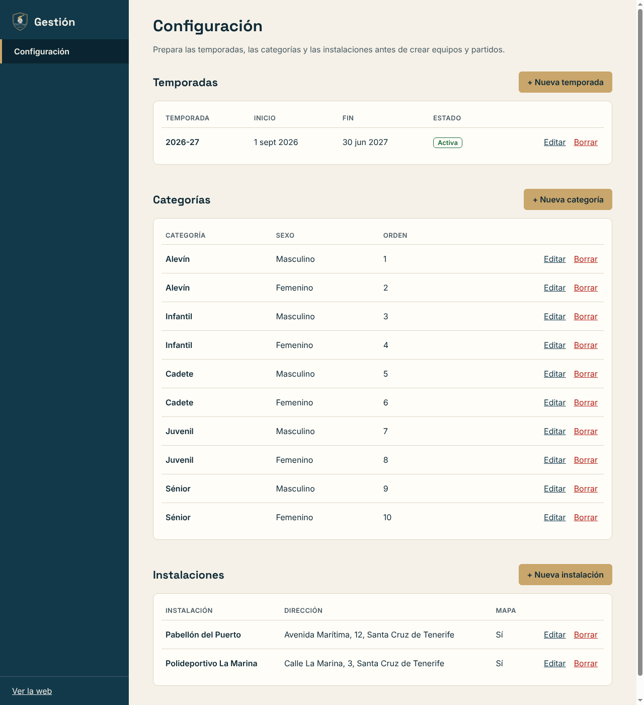
  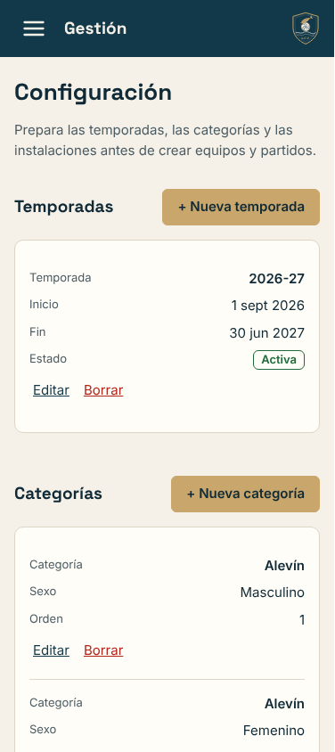

- **Qué mejorar:**
  - Probar siempre el SSR compilado (`node dist/frontend/server/server.mjs`), no solo `pnpm start`: dos fallos solo aparecieron así (el `Host` no permitido sin `NG_ALLOWED_HOSTS` y el `Location` de los 201 sin puerto).
  - Revisar la Definition of Ready al empezar el sprint y no al coger la historia: el #59 aún tenía sin marcar el diseño aunque ya estaba definido.
  - Los estilos que se repiten (botones, campos, avisos) van en `src/styles/_controls.scss` desde el principio: cada componente tiene un límite de 4 kB de estilos.

### Sprint 2: login y sesión

Terminado el 2026-11-24 con 13 de 13 puntos; objetivo cumplido.

- **Demo:** `/gestion` sin sesión lleva a `/login` y, tras entrar, vuelve a la página pedida; con una contraseña mala sale «Email o contraseña incorrectos». Al recargar la página la sesión sigue abierta, porque el navegador guarda el refresh token en una cookie `HttpOnly` que JavaScript no puede leer. «Cerrar sesión» lleva a la portada, borra la cookie y `/gestion` vuelve a pedir el login. Si se reutiliza un refresh token ya usado, se cierran todas las sesiones del usuario (`SessionIT`).

  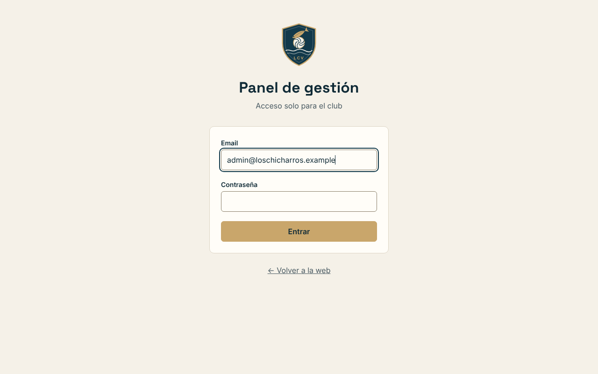
  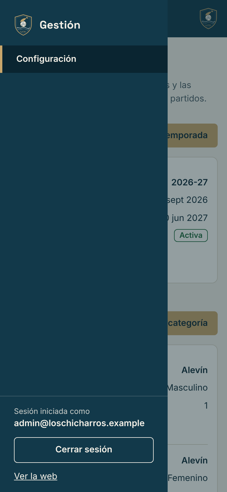

- **Qué mejorar:**
  - Comprobar la configuración real además de los tests: el bloque `app:` no había entrado en `application.yml` y los tests pasaban porque `application-test.yml` lo define; solo la prueba de punta a punta lo detectó.
  - Cada variable nueva se documenta en `.env.example` con sus mínimos y se valida al arrancar con un mensaje que diga si falta o si no cumple el mínimo: un `ADMIN_PASSWORD` de menos de 12 caracteres en el `.env` paró la API al probarla en local.
  - No repetir un bloque de comandos ya ejecutado aunque no se haya pegado la salida: crea issues y ramas duplicados (pasó con el #114). Antes de repetirlo, comprobar con `git log --oneline -1` y `gh pr list`.

### Sprint 3: personas y equipos

Terminado el 2026-11-26 con 12 de 12 puntos; objetivo cumplido.

- **Demo:** `/gestion/equipos` con los 68 equipos de la semilla filtrados por temporada y categoría; la plantilla de Cadete femenina muestra dorsal, jugadora («Lucía R.», como se verá en la web pública) y posición, rechaza un dorsal ocupado con 409 y acepta el 99. `/gestion/personas` busca sin distinguir mayúsculas ni tildes y pagina las 124 personas, también en móvil. Tras 5 contraseñas malas, el login de ese email desde esa IP queda bloqueado 15 minutos con el mismo mensaje genérico; con más de 20 peticiones por minuto a `/auth/**` la API responde 429 y el login avisa «Demasiados intentos». Swagger (`/swagger-ui`) documenta toda la API y `OpenApiIT` comprueba que coincide con el contrato.

  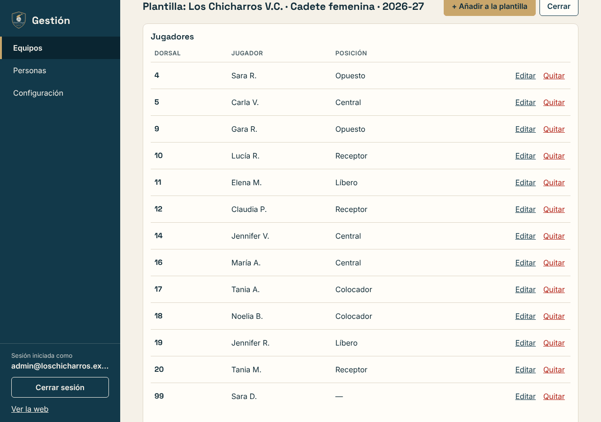
  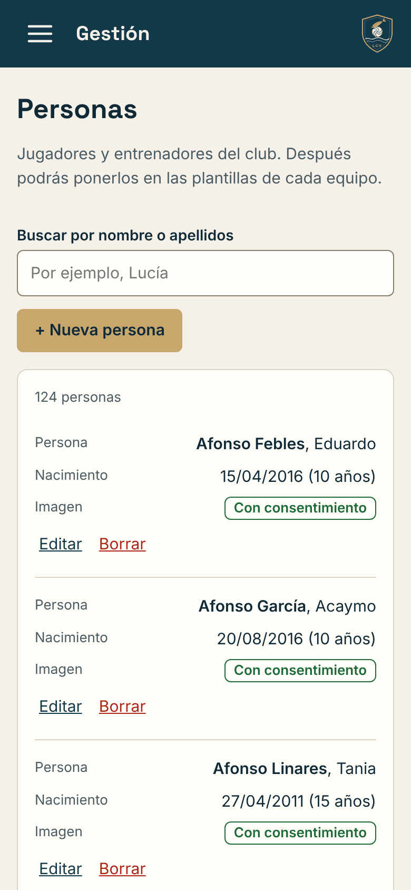
  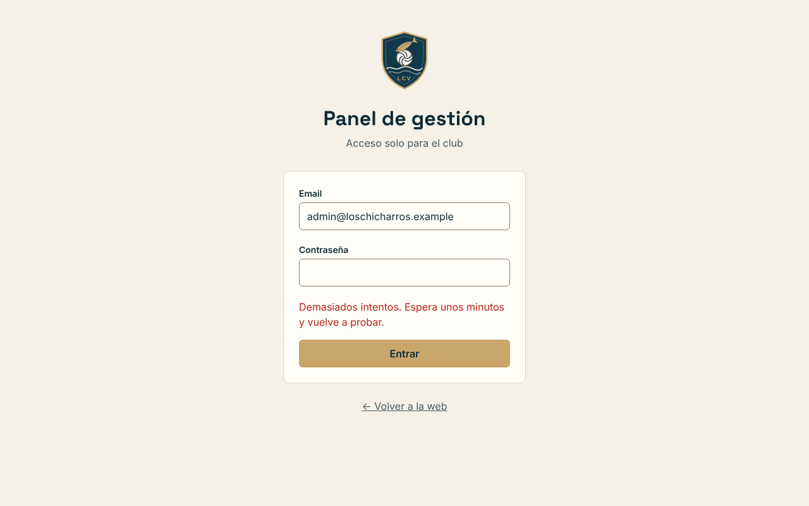

- **Qué mejorar:**
  - Probar las anotaciones de Hibernate con datos que cambian con el tiempo: `@SQLRestriction` en `Person` quitaba a las personas borradas también de las plantillas de temporadas pasadas; lo detectó `TeamControllerIT` y se sustituyó por filtros explícitos en el repositorio (regla 18 de Java).
  - En las pruebas a mano de un límite de peticiones, tener en cuenta cómo se recarga: con `refillGreedy` el cubo recupera un permiso cada 3 segundos, así que unas peticiones espaciadas no lo agotan y pareció que el 429 no saltaba. Se comprueba con ráfagas o mirando las respuestas, no solo la pantalla.
  - El bloqueo por IP depende de que la API sepa la IP real del usuario: antes del despliegue (sprint 9) hay que decidir cómo se fía del `X-Forwarded-For` del SSR en Render; si no, todos los usuarios comparten la IP del SSR y el límite.

### Sprint 4: competiciones, partidos y resultados

Terminado el 2026-11-28 con 13 de 13 puntos; objetivo cumplido.

- **Demo:** `/gestion/competiciones` con las diez ligas de la semilla; al añadir jornadas, el formulario propone el siguiente número y la siguiente fecha (con el intervalo de las dos últimas) y rechaza una fecha fuera de la temporada. `/gestion/partidos` muestra cada jornada con sus partidos en la hora de Canarias, aunque la API las guarde en UTC; un partido se aplaza, se cancela o se reprograma desde su fila, y el marcador en sets se introduce o se corrige solo si el partido ya ha empezado (un 3-3 se rechaza antes de enviarlo). `/gestion/competiciones/:id/clasificacion` deja escribir la tabla de cada liga: una fila incoherente (ganados y perdidos que no suman los jugados) se marca sin enviar nada, y al guardar la tabla vuelve ordenada por puntos, ganados y cociente de sets. Todo se lee sin sesión desde la API (`GET /competitions`, `/matches`, `/competitions/{id}/standings`) para las páginas públicas de los sprints 7 y 8.

  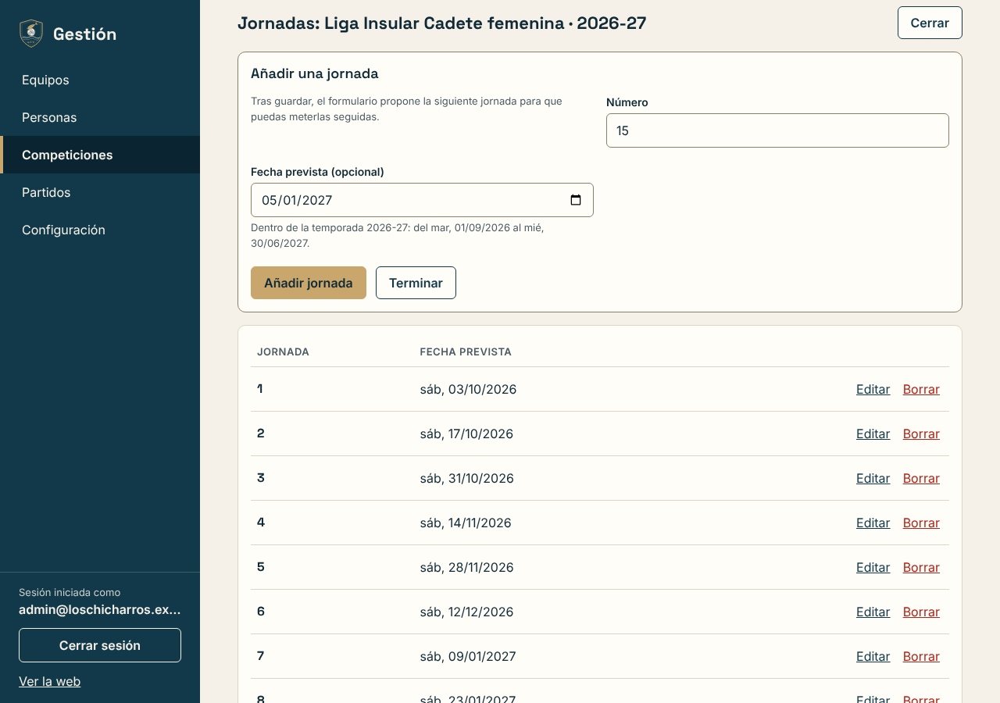
  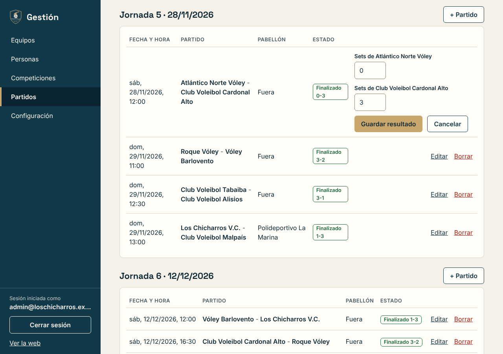
  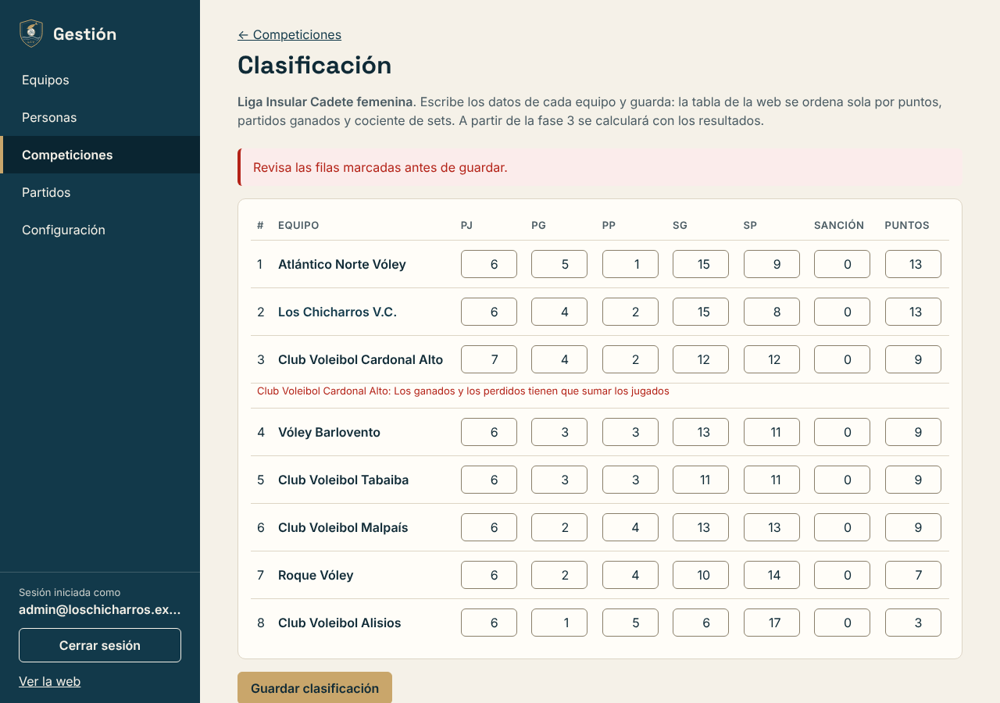
  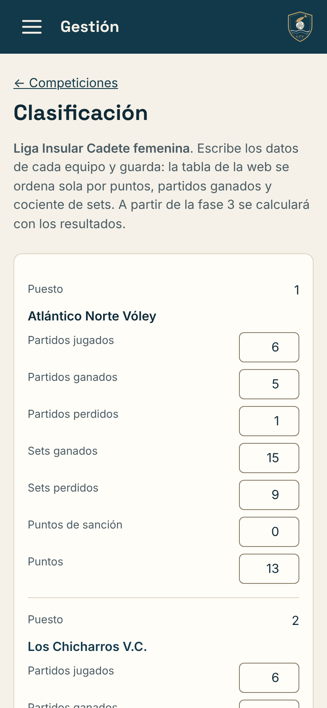

- **Qué mejorar:**
  - Todo `<form>` con `(ngSubmit)` lleva `[formGroup]`: sin él, el envío no hace nada y solo lo detectaron los tests, dos veces (en el #63 y en el #65). Queda en la regla 8 de TypeScript y Angular.
  - No usar `@Modifying(clearAutomatically = true)` si después se usan entidades ya cargadas: las desconecta y su relación perezosa falla con `LazyInitializationException` (#65). Queda en la regla 8 de Java.
  - Las horas viajan en UTC y los días se cuentan en la hora de Canarias, siempre con `ClubTime` en el backend y `club-time.ts` en el panel, nunca con la zona del servidor ni la del navegador. Queda en la regla 7 de Java, antes de que la fase 3 calcule la clasificación con las fechas de los partidos.
  - Al terminar, la nueva página de clasificación tenía un borde de más bajo el nombre del último equipo: `crud-panel.scss` no contemplaba cabeceras de fila (`<th scope="row">`) en el cuerpo de la tabla. Corregido en el cierre; las tablas de las páginas públicas tendrán que tenerlo en cuenta.

## Tareas técnicas

| Id | Tarea | Puntos | Sprint |
| --- | --- | --- | --- |
| T01 | #83 Spotless y Checkstyle en el backend | 2 | Sprint 0 |
| T02 | #84 Husky y lint-staged (pre-commit) | 2 | Sprint 0 |
| T03 | #85 JaCoCo y cobertura en la CI | 1 | Sprint 0 |
| T04 | #86 Datos de ejemplo e imágenes libres | 3 | Sprint 0 |
| T05 | #87 Base del backend: errores, auditoría y tests de integración | 3 | Sprint 1 |
| T06 | #88 Base del frontend: tokens, fuentes, layout y navegación | 3 | Sprint 1 |
| T07 | #89 Proxy de /api en el SSR y configuración por entorno | 3 | Sprint 1 |
| T08 | #90 Swagger con springdoc | 1 | Sprint 3 |
| T09 | #91 Actuator y despertar de la API desde el SSR | 1 | Sprint 1 |
| T10 | #92 Smoke tras desplegar | 2 | Sprint 5 |
| T11 | #93 Playwright y E2E de la release | 3 | Sprint 8 |
| T12 | #94 Primer despliegue en Render y TiDB Cloud Starter | 5 | Sprint 9 |
| T13 | #95 Workflow de despliegue a producción | 5 | Sprint 9 |
| T14 | #96 Copias de seguridad de club_prod | 3 | Sprint 10 |
| T15 | #97 Monitor de caídas y memoria de la API | 2 | Sprint 10 |

## Decisiones

- **1 punto ≈ 1,5 horas** como punto de partida, a recalibrar tras el sprint 1. Se mantuvo al cerrar el sprint 1 (decidido el 2026-11-23) porque los dos primeros sprints no son representativos. Al cerrar el sprint 2 (decidido el 2026-11-24) se deja de recalibrar en horas y **se planifica por velocidad** (puntos terminados por sprint, ahora 13); las horas por punto quedan solo como referencia. Al cerrar el sprint 3 (decidido el 2026-11-26) la velocidad sigue en 13: un sprint que termina todo lo planificado no la baja aunque llevara menos puntos. Al cerrar el sprint 4 (2026-11-28) se mantiene en 13.
- **Sprint 0** para cerrar la fase 0 con las herramientas de calidad (Spotless, Checkstyle, Husky, JaCoCo) y los datos de ejemplo antes de escribir código de negocio.
- **Sprint y puntos como campos del tablero**, no como etiquetas: un campo de selección «Sprint» y un campo numérico «Puntos».
- **El despliegue va al final**, en los sprints 9 y 10; hasta entonces la demo de cada sprint se hace en local. El sprint 10 es corto a propósito, para dejar margen a los arreglos de la release.
