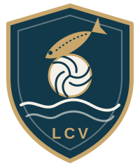

# Ficha del club

Última revisión: 2026-11-22.

Los Chicharros V.C. es un club de voleibol **ficticio** de Santa Cruz de Tenerife. Todos los datos de este documento (pabellones, rivales, competiciones, personas) son inventados para los datos de ejemplo de la web; cualquier parecido con clubes o instalaciones reales es casual. El nombre del club sigue siendo provisional.

## Datos generales

| Dato | Valor |
| --- | --- |
| Nombre | Los Chicharros Voleibol Club (Los Chicharros V.C.) |
| Siglas | LCV |
| Ciudad | Santa Cruz de Tenerife (Canarias) |
| Por qué el nombre | «Chicharros» es el apodo de la gente de Santa Cruz; el chicharro es un pez muy de la costa de la ciudad |
| Fundación | 1998 (ficticia) |
| Colores | Azul petróleo y arena, con detalles en latón ([paleta](../02-requisitos/paleta-colores.md)) |
| Prefijo de los selectores Angular | `cv-` (provisional, como el nombre) |

## Pabellones

| Pabellón | Uso | Dirección (ficticia) |
| --- | --- | --- |
| Pabellón del Puerto | Partidos de sénior y juvenil, entrenamientos | Avenida Marítima, 12, Santa Cruz de Tenerife |
| Polideportivo La Marina | Partidos y entrenamientos de la cantera | Calle La Marina, 3, Santa Cruz de Tenerife |

## Categorías

Las edades de la temporada 2026-27 siguen el criterio habitual en el voleibol español: cada categoría agrupa dos años de nacimiento. Cada federación fija los suyos; estos son los del ejemplo.

| Categoría | Años de nacimiento | Equipos del club |
| --- | --- | --- |
| Alevín | 2015 y 2016 | Masculino y femenino |
| Infantil | 2013 y 2014 | Masculino y femenino |
| Cadete | 2011 y 2012 | Masculino y femenino |
| Juvenil | 2009 y 2010 | Masculino y femenino |
| Sénior | 2008 y anteriores | Masculino y femenino |

El club tiene 10 equipos en la temporada 2026-27. Los de alevín a juvenil son de menores: sus jugadores son `Person` sin cuenta, gestionados por sus tutores ([ADR-003](../adr/003-person-user-split.md)).

## Competiciones de ejemplo

Cada equipo juega una liga insular de su categoría y sexo, organizada por una federación ficticia. Todas usan el sistema de puntos del [plan](../00-plan/plan-proyecto.md) (3-0 y 3-1: 3 puntos; 3-2: 2 y 1) y una sanción de 1 punto por incomparecencia.

| Competición | Equipos | Formato |
| --- | --- | --- |
| Liga Insular Alevín (masculina y femenina) | 6 por liga | Ida y vuelta, 10 jornadas |
| Liga Insular Infantil (masculina y femenina) | 6 por liga | Ida y vuelta, 10 jornadas |
| Liga Insular Cadete (masculina y femenina) | 8 por liga | Ida y vuelta, 14 jornadas |
| Liga Insular Juvenil (masculina y femenina) | 6 por liga | Ida y vuelta, 10 jornadas |
| Liga Insular Sénior (masculina y femenina) | 8 por liga | Ida y vuelta, 14 jornadas |

## Clubes rivales (ficticios)

| Club | Siglas |
| --- | --- |
| Club Voleibol Alisios | CVA |
| Vóley Barlovento | VBA |
| Club Voleibol Malpaís | CVM |
| Roque Vóley | RQV |
| Club Voleibol Tabaiba | CVT |
| Atlántico Norte Vóley | ANV |
| Club Voleibol Cardonal Alto | CCA |

Para las ligas de 6 equipos se usan los cinco primeros; para las de 8, los siete.
