# Wireframes y guía visual

Última revisión: 2026-11-23.

Bocetos de las pantallas clave de la fase 1 y la tipografía de la web. Es el entregable del paso 11 de la planificación. Los colores son los de la [paleta Atlántico y arena](paleta-colores.md) y los textos y datos son de ejemplo ([ficha del club](../01-vision/club.md)). Son bocetos de alta fidelidad hechos en HTML con los colores y las fuentes reales: muestran la estructura y la jerarquía, pero el diseño final se ajusta al programar cada pantalla.

Las pantallas públicas se dibujan en móvil (390 px), porque la web se diseña de móvil a escritorio; el panel de gestión, en escritorio (1280 px), porque es donde más se trabaja con él, y también en móvil.

## Web pública (móvil)

### Portada (H01)

Noticia destacada, próximos partidos, últimos resultados y más noticias.

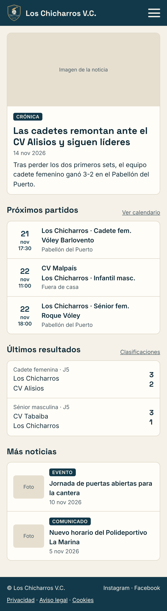

### Listado de noticias (H02)

Filtro por tipo y paginación.

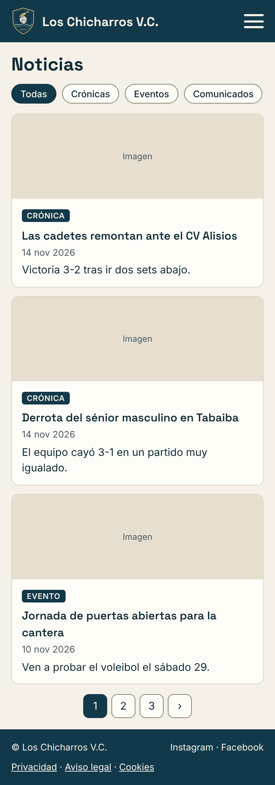

### Detalle de noticia (H03)

Imagen, cuerpo con formato y botón para compartir.

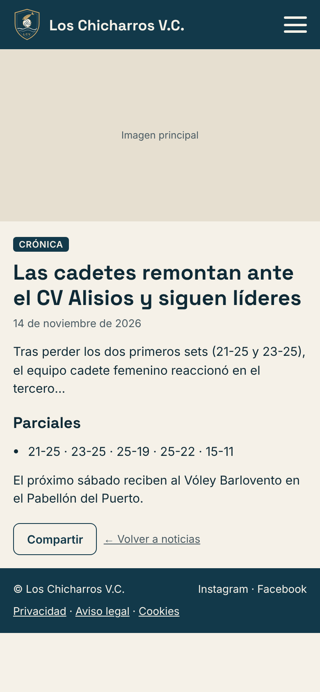

### Ficha de equipo (H04)

Entrenadores y plantilla con dorsal; avatar genérico sin consentimiento de imagen.

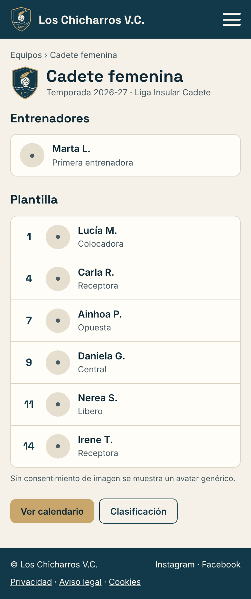

### Calendario (H05)

Filtros de equipo y pabellón, agrupado por día; el partido aplazado va marcado.

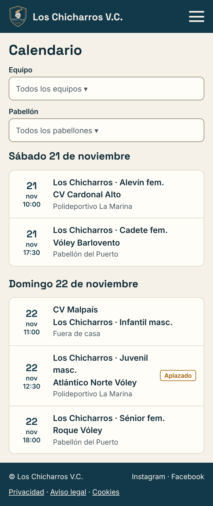

### Clasificación (H06)

El club resaltado, el criterio de desempate y los resultados por jornada.

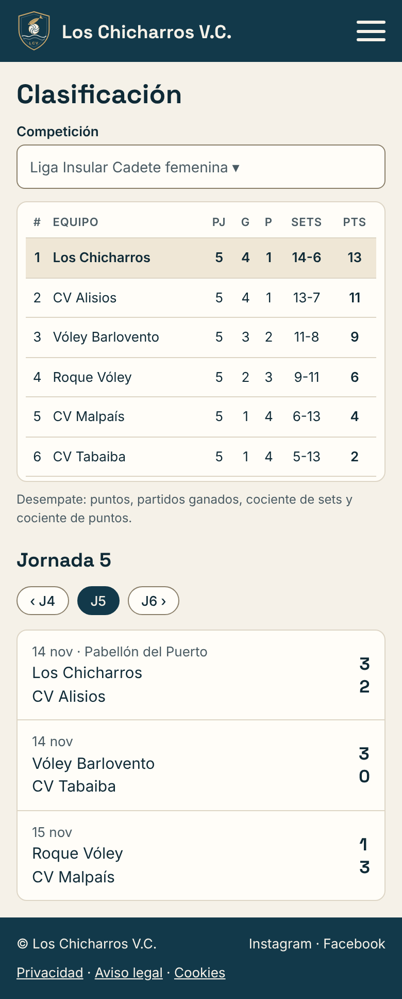

## Panel de gestión

### Login (móvil) (H09, H11)

Un solo mensaje de error para cualquier fallo.

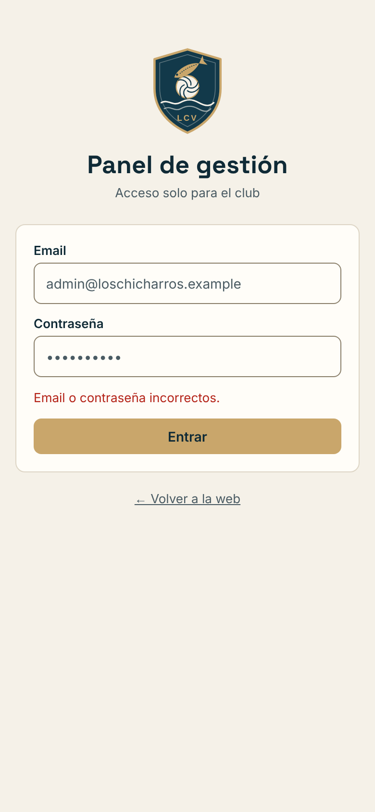

### Listado de noticias del panel (H12)

Estado, destacada y acciones.

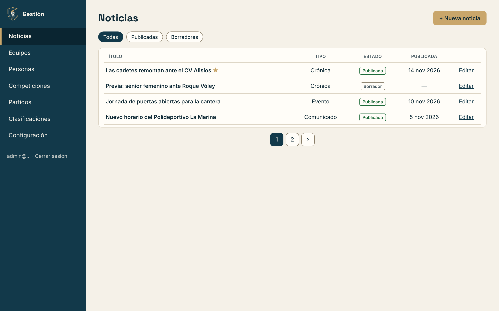

### Editor de noticia (H12, H13, H14)

Formulario, imagen, Markdown con vista previa y borrador guardado en el navegador.

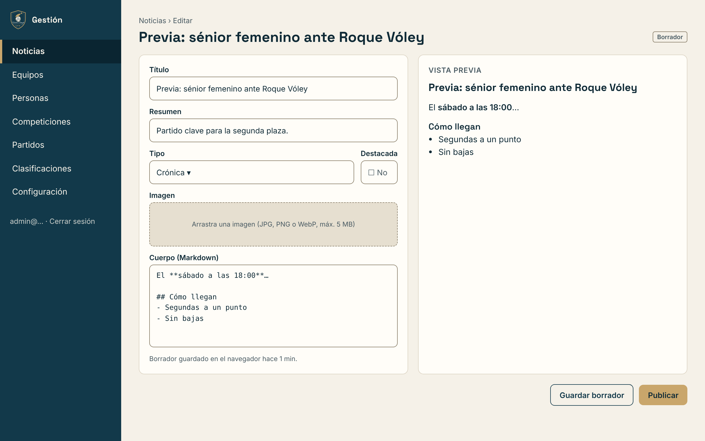

### Panel en el móvil (H12)

En el móvil, el menú lateral se convierte en un menú desplegable desde el botón de la cabecera, con el mismo bloque de sesión y el botón «Cerrar sesión» abajo. Los listados del panel pasan de tabla a tarjetas.

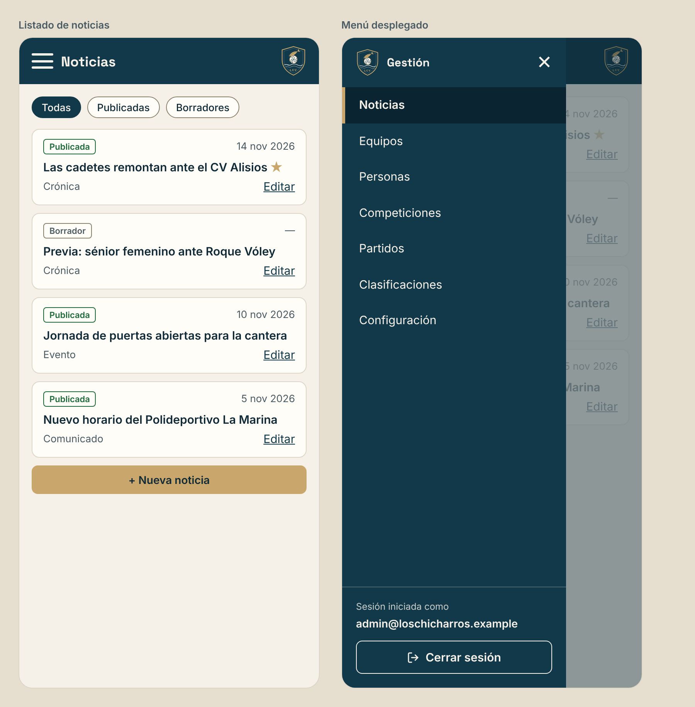

Las demás pantallas del panel (equipos, personas, competiciones, partidos, clasificación y configuración) siguen el mismo patrón: menú lateral, listado con filtros y formulario.

## Navegación

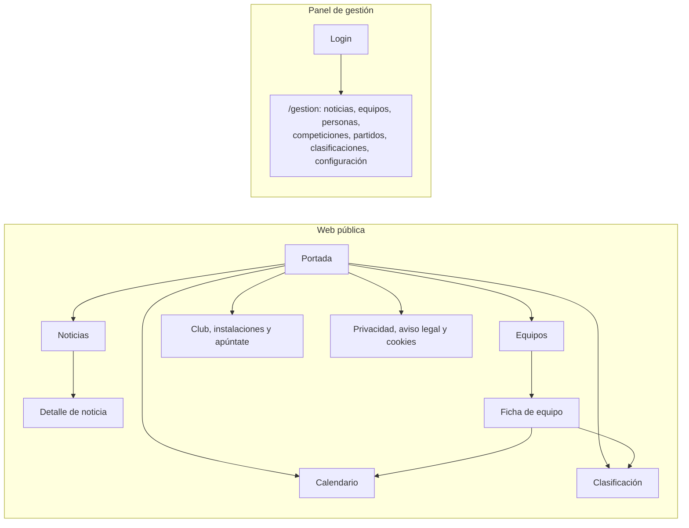

## Tipografía

| Uso | Fuente | Peso | Tamaño en móvil / escritorio |
| --- | --- | --- | --- |
| Título de página (`h1`) | Space Grotesk | 700 | 26 / 32 px |
| Título de sección (`h2`) | Space Grotesk | 700 | 19 / 22 px |
| Subtítulo (`h3`), marcadores y dorsales | Space Grotesk | 600-700 | 16 / 18 px |
| Texto | Inter | 400 | 15 / 16 px, interlineado 1,5 |
| Etiquetas de campo y botones | Inter | 600 | 13-14 px |
| Fechas, notas y textos de apoyo | Inter | 400 | 13 px, color `--color-text-secondary` |
| Etiquetas de tipo de noticia y cabeceras de tabla | Inter | 600 | 11 px, mayúsculas |
| Editor de Markdown | Monoespaciada del sistema | 400 | 13 px |

Reglas:

- Las fuentes se sirven desde la propia web con los paquetes `@fontsource/inter` y `@fontsource/space-grotesk`, no desde Google Fonts: así no se envían datos de los visitantes a terceros (RGPD) y no depende de otro servidor.
- Solo se cargan los pesos de la tabla, con `font-display: swap`.
- Los tamaños, como los colores, salen de variables en `src/styles/_tokens.scss`.

## Patrones de interfaz

- **Cabecera:** azul petróleo con el escudo, el nombre y el menú; en escritorio, el menú se despliega en línea.
- **Tarjetas:** fondo blanco cálido, borde decorativo y esquinas de 10 px.
- **Botón principal:** latón con texto azul tinta; **secundario:** borde azul petróleo sin relleno.
- **Partidos:** fecha y hora a la izquierda, equipos en el centro y marcador o estado a la derecha.
- **Estados:** aplazado en ámbar, publicado en verde y borrador en gris, siempre con texto además del color.
- **Cerrar sesión (panel):** abajo del menú lateral, siempre visible: con quién se ha iniciado sesión y un botón con borde e icono, no un enlace pequeño.
- **Campos:** borde de campo de la paleta y el error en rojo teja debajo del campo.

## Decisiones

Confirmadas el 2026-11-23.

- **Fuentes servidas desde la propia web** en lugar de Google Fonts.
- **Escala tipográfica** de la tabla anterior.
- **Bocetos en HTML** en lugar de Figma o Excalidraw: se hacen con la paleta y las fuentes reales y sirven de referencia directa para los componentes.
