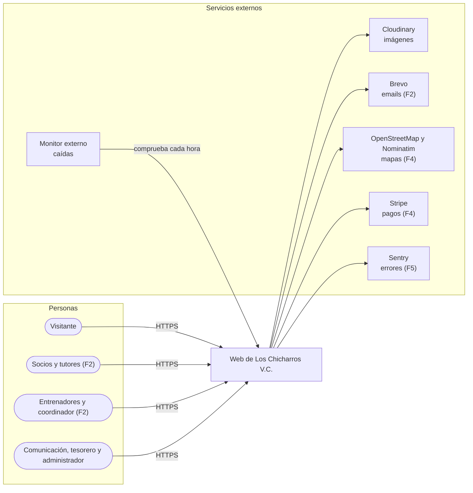
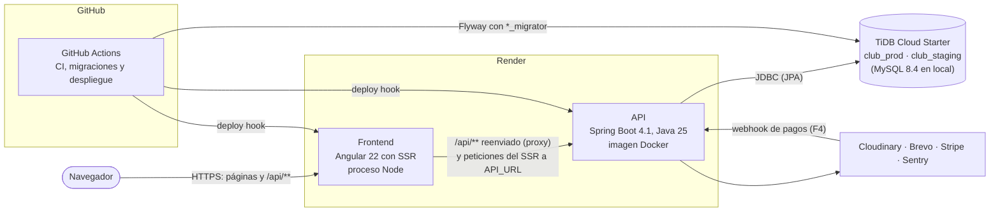
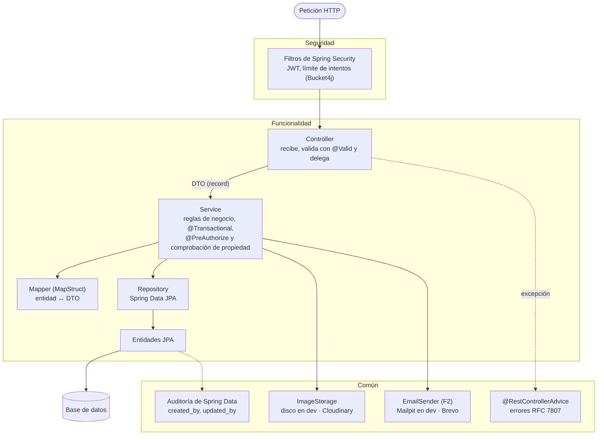
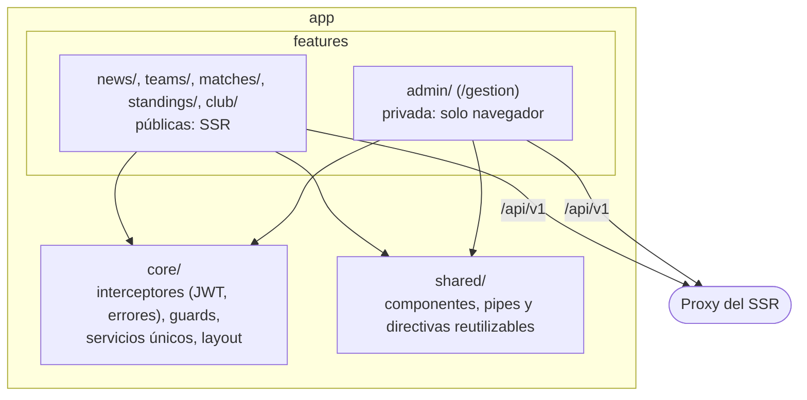

# Arquitectura

Última revisión: 2026-11-22.

Cómo está montada la web: con quién se relaciona, de qué piezas se compone y cómo se organiza el backend por dentro. Es el entregable del paso 8 de la planificación, con diagramas C4 de contexto y de contenedores. Las decisiones de fondo están en los [ADR](../adr/README.md) y las reglas de cada pieza en las [reglas técnicas](../07-desarrollo/reglas-tecnicas.md).

## Contexto

Quién usa la web y con qué servicios externos habla. Entre paréntesis, la fase en la que entra cada uno.

## Contenedores

Las piezas que se despliegan y cómo se comunican. El navegador solo habla con el frontend, que reenvía `/api` a la API ([ADR-004](../adr/004-ssr-api-proxy.md)).

| Contenedor | Tecnología | Responsabilidad |
| --- | --- | --- |
| Frontend | Angular 22 con SSR en Node 24, en Render | Renderizar las páginas públicas en el servidor, servir la aplicación y hacer de proxy de `/api` |
| API | Spring Boot 4.1 con Java 25, imagen Docker en Render | Lógica de negocio, seguridad, validación y acceso a datos |
| Base de datos | TiDB Cloud Starter (`staging` y `prod`); MySQL 8.4 en local y en los tests | Guardar los datos; el esquema solo cambia con Flyway |
| GitHub Actions | Workflows del repositorio | CI en cada PR, migraciones y despliegue con aprobación manual |

## Capas del backend

Un paquete por funcionalidad (`news`, `matches`, `teams`…) con estas capas dentro. La lógica de negocio vive siempre en los servicios.

Reglas que se ven en el diagrama:

- Las entidades JPA nunca salen del servicio: al controlador le llegan DTOs (`record`).
- El controlador no tiene lógica ni toca repositorios.
- Los servicios externos se usan siempre a través de una interfaz (`ImageStorage`, `EmailSender`) cuya implementación elige el perfil de Spring.
- Los errores se convierten en `ProblemDetail` en un único sitio.

## Estructura del frontend

Cada funcionalidad tiene sus páginas, sus componentes, su `*.service.ts` (el único que llama a la API, a través de los interceptores de `core/`) y su `*.models.ts`, y se carga de forma diferida. Qué rutas se renderizan en el servidor lo decide `app.routes.server.ts`.
