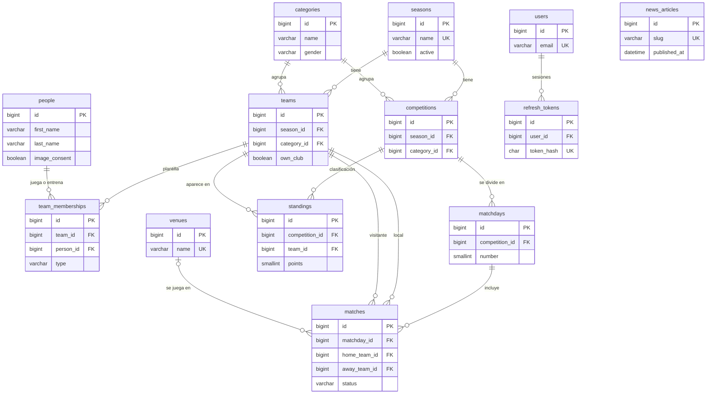
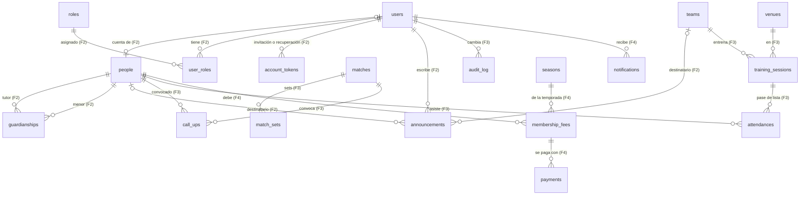

# Modelo de datos: diagrama entidad-relación

Última revisión: 2026-11-22.

Modelo de todo el proyecto a alto nivel. Es el entregable del paso 7 de la planificación, junto con el [diccionario de datos de la fase 1](diccionario-fase-1.md); el de cada fase siguiente se escribe al planificarla. Los nombres son los de la base de datos (en inglés y en plural, según las [reglas técnicas](../07-desarrollo/reglas-tecnicas.md)); su equivalente en español está en el [glosario](../01-vision/glosario.md).

## Fase 1

Lo necesario para la web pública y el panel del administrador.

`news_articles` no se relaciona con otras tablas. Las columnas `created_by` y `updated_by` de las tablas de negocio apuntan a `users`, pero no se dibujan para que el diagrama se pueda leer.

## Fases 2 a 4

Lo que se añade después, con las tablas de la fase 1 de las que depende.

En la fase 3 la tabla `matches` gana `forfeited_team_id`, y `standings` deja de editarse a mano: la calcula el servicio de clasificación a partir de los partidos.

## Decisiones del modelo

Confirmadas el 2026-11-22.

- **`Person` y `User` separados** ([ADR-003](../adr/003-person-user-split.md)): la relación se añade en la fase 2 con la columna `users.person_id`, única y opcional.
- **Rivales en la misma tabla:** los equipos rivales son filas de `teams` con `own_club = false`, para que partidos y clasificaciones traten a todos igual.
- **Pabellón opcional en el partido:** solo se guardan los pabellones donde juega el club; un partido fuera de casa puede no tenerlo.
- **Una sola temporada activa:** lo garantiza el servicio, porque MySQL y TiDB no admiten un índice único sobre solo las filas con `active = true`.
