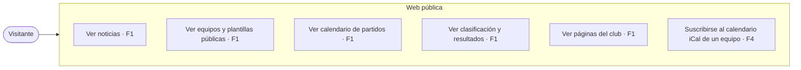
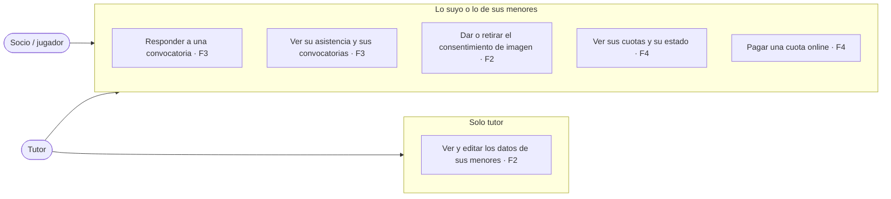
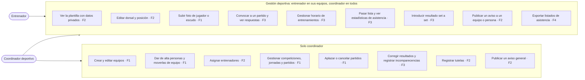
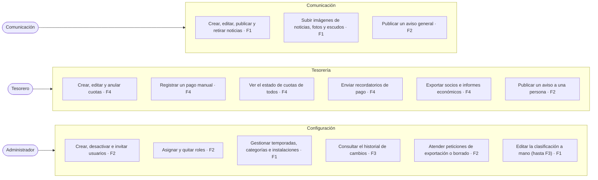

# Casos de uso por rol

Última revisión: 2026-11-22.

Qué puede hacer cada rol en la web, en todo el proyecto. Cada caso de uso indica la fase en la que se implementa (F1 a F4). Los permisos exactos, incluida la diferencia entre «sobre cualquier registro» y «solo sobre lo suyo», están en la [matriz de permisos](../02-requisitos/matriz-permisos.md); si este documento y la matriz no coinciden, manda la matriz.

Reglas generales:

- Los permisos se suman: quien tiene varios roles hace lo que permita cualquiera de ellos.
- Lo que puede el visitante lo puede cualquier usuario con sesión.
- Todo usuario con sesión puede ver y editar su perfil, ver sus equipos y partidos, leer sus avisos y pedir la exportación o el borrado de sus datos (F2). Para no repetirlo, no aparece en cada diagrama.
- En la fase 1 solo existe el administrador; el resto de roles llega en la fase 2.

## Visitante

## Socio y tutor

El tutor hace por sus menores lo mismo que el socio hace por sí mismo.

## Entrenador y coordinador deportivo

El entrenador actúa solo sobre sus equipos; el coordinador, sobre todos.

## Comunicación, tesorero y administrador

El administrador puede hacer además todo lo de comunicación, tesorería, coordinador y entrenador; no se dibuja para que el diagrama se pueda leer.

## Casos de uso de la fase 1

En la fase 1 solo hay visitante y administrador. El administrador hace todos los casos marcados como F1 de cualquier rol:

| Rol | Casos de uso F1 |
| --- | --- |
| Visitante | Ver noticias, equipos, calendario, clasificación y páginas del club |
| Administrador | Iniciar y cerrar sesión; noticias e imágenes; equipos, personas y plantillas; competiciones, jornadas y partidos (incluido aplazar o cancelar); marcador de sets; clasificación a mano; temporadas, categorías e instalaciones |
