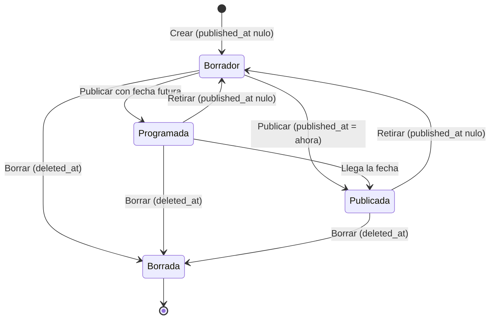

# Estados: noticia

Última revisión: 2026-11-28.

Ciclo de vida de una noticia. No hay columna de estado: se deduce de `published_at` y `deleted_at`.

| Estado | Cómo se reconoce | Se ve en la web pública |
| --- | --- | --- |
| Borrador | `published_at` nulo | No |
| Programada | `published_at` con una fecha futura (desde el #56) | No, hasta esa fecha |
| Publicada | `published_at` con una fecha pasada | Sí |
| Borrada | `deleted_at` con fecha (borrado lógico) | No, ni en el panel |
