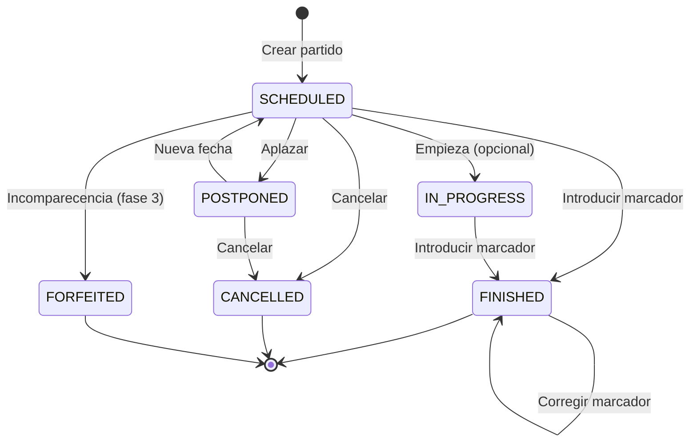

# Estados: partido

Última revisión: 2026-11-23.

Estados por los que pasa un partido (`matches.status`) y quién los cambia. En la fase 1 todos los cambios los hace el administrador.

| Estado | Significado | ¿Cuenta en la clasificación? |
| --- | --- | --- |
| `SCHEDULED` | Programado | No |
| `IN_PROGRESS` | En juego | No |
| `FINISHED` | Terminado, con marcador de sets | Sí |
| `POSTPONED` | Aplazado; espera nueva fecha | No |
| `CANCELLED` | No se jugará | No |
| `FORFEITED` | Un equipo no se presentó: 3-0 y puntos de sanción (fase 3) | Sí |
