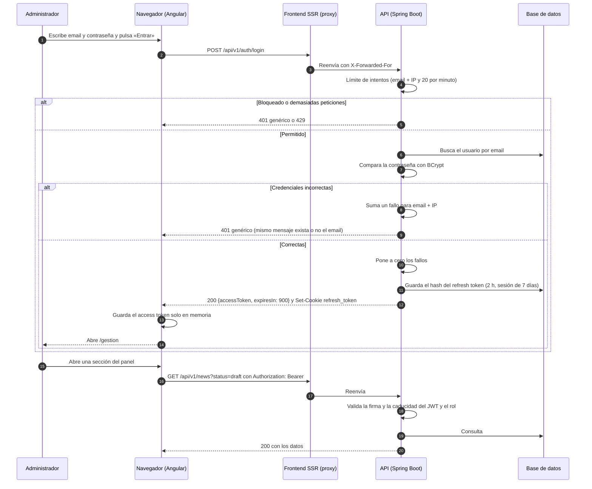

# Secuencia: login del administrador

Última revisión: 2026-11-23.

Cómo entra el administrador en el panel y cómo accede después a una ruta protegida (historias H09 y H11). Todas las peticiones del navegador pasan por el proxy del SSR ([ADR-004](../adr/004-ssr-api-proxy.md)).

- El access token nunca se guarda en `localStorage` ni `sessionStorage`.
- La cookie lleva `HttpOnly`, `Secure`, `SameSite=Strict` y `Path=/api/v1/auth`, así que solo viaja a las rutas de autenticación.
