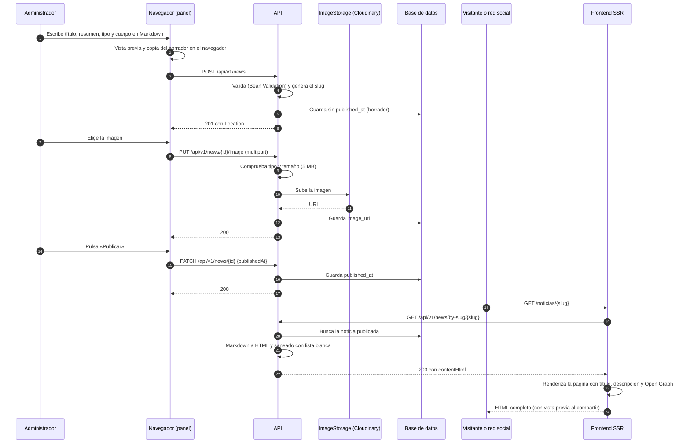

# Secuencia: publicar una noticia

Última revisión: 2026-11-23.

Del borrador a la noticia publicada y compartida en redes (historias H12, H13, H14 y H03).

- El frontend nunca sanea HTML por su cuenta: inserta el que devuelve la API.
- Una noticia retirada vuelve a borrador con `PATCH {publishedAt: null}` y la web pública responde 404.
