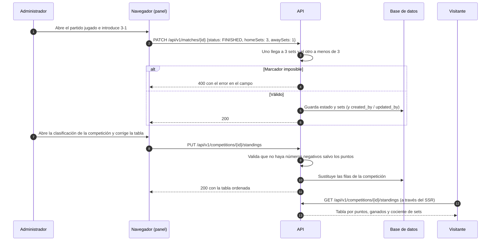

# Secuencia: introducir un resultado

Última revisión: 2026-11-23.

Cómo registra el administrador el resultado de un partido y actualiza la clasificación en la fase 1 (historias H20 y H21). En la fase 3 el resultado será set a set y la clasificación se recalculará sola.

- En la fase 1 la clasificación se edita a mano; el resultado y la tabla son dos pasos separados.
- Desde la fase 3, guardar el resultado recalcula la tabla en el servicio de clasificación y deja rastro en el historial de cambios.
