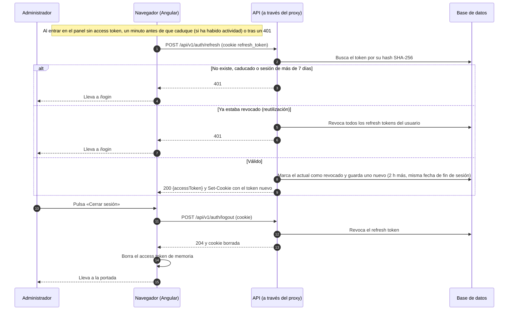

# Secuencia: renovación y cierre de sesión

Última revisión: 2026-11-23.

Cómo se mantiene viva la sesión mientras el administrador trabaja, qué pasa si alguien reutiliza un refresh token robado y cómo se cierra (historia H10).

- La sesión es deslizante: cada renovación alarga 2 horas, pero nunca más allá de 7 días desde el login.
- Sin actividad, el frontend no renueva: el access token caduca y, si pasan 2 horas, también el refresh token, así que hay que volver a entrar. Si la API responde 401 a una petición, el frontend renueva una vez y la repite.
- Cualquier 401 de `/refresh` borra la cookie (`Max-Age=0`).
- Si dos pestañas renuevan a la vez, la segunda usa un token ya rotado y cierra la sesión; el frontend centraliza la renovación en un único servicio para evitarlo.
