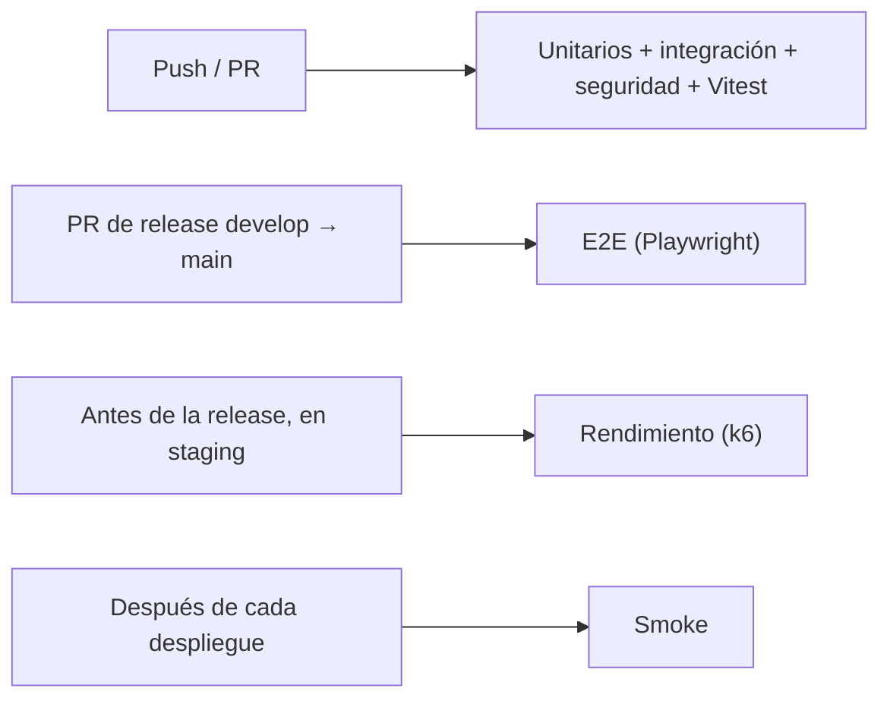

# Guía de tests

Última revisión: 2026-11-22.

Esta guía explica cómo se escribe, dónde vive y cómo se ejecuta cada tipo de test del proyecto. Las [pautas](../00-plan/pautas-proyecto.md) dicen qué tests exige la Definition of Done, y las [reglas técnicas](reglas-tecnicas.md) fijan los nombres y los entornos. La [matriz de permisos](../02-requisitos/matriz-permisos.md) es la fuente de los tests de seguridad.

## Resumen

| Tipo | Dónde vive | Herramienta | Comando | Cuándo se ejecuta | Qué bloquea si falla |
| --- | --- | --- | --- | --- | --- |
| Unitario (backend) | `backend/src/test/java`, `<Clase>Test` | JUnit 5, Mockito, AssertJ | `./mvnw test` | Cada push y PR (`backend-test`) | El PR |
| Integración (backend) | `backend/src/test/java`, `<Clase>IT` | Spring Boot Test, MockMvc, Testcontainers (MySQL 8.4) | `./mvnw verify` | Cada push y PR (`backend-test`) | El PR |
| Seguridad (backend) | `<Recurso>SecurityIT` | Igual que integración | `./mvnw verify` | Cada push y PR (`backend-test`) | El PR |
| Unitario y de componentes (frontend) | Junto al fichero: `<nombre>.spec.ts` | Vitest | `pnpm test` | Cada push y PR (`frontend-test`) | El PR |
| Extremo a extremo (E2E) | `frontend/e2e/` | Playwright | `pnpm exec playwright test` | PR de release `develop → main` (`e2e`) | La release |
| Smoke | `scripts/smoke.sh` | `curl` en GitHub Actions | `./scripts/smoke.sh <web> <api> <entorno>` | Después de cada despliegue a `staging` y `prod` | La release (en `staging`); obliga a volver atrás (en `prod`) |
| Rendimiento | `perf/` | k6 | `k6 run perf/public-read.js` | A mano, antes de cada release, contra `staging` | La release, hasta explicar o arreglar la regresión |

La pirámide se respeta: muchos unitarios (rápidos), bastantes de integración, pocos E2E y un único smoke por despliegue.



## Reglas comunes

1. **Un test, una conducta.** El nombre dice el resultado y la condición: `should<Resultado>When<Condición>` en Java y `'should <resultado> when <condición>'` en TypeScript.
2. **Dado / Cuando / Entonces.** Cada test tiene esos tres bloques, separados por una línea en blanco o por los comentarios `// Dado`, `// Cuando` y `// Entonces`. Los criterios de aceptación de las historias ya vienen en ese formato y se convierten casi literalmente en tests.
3. **Independientes.** Ningún test depende del orden, de los datos de otro test ni de la hora real. Lo que dependa de la fecha recibe un `Clock` inyectado, y el test usa `Clock.fixed(...)`.
4. **Sin servicios externos.** Ningún test llama a Cloudinary, Brevo, Stripe ni a internet. En el perfil `test`, `ImageStorage` escribe en una carpeta temporal y `EmailSender` guarda los emails en memoria para que el test los compruebe.
5. **Sin datos reales.** Los emails son `@example.com` y las contraseñas de prueba solo existen en la semilla, en los fixtures o en `.env.example`.
6. **Un bug empieza por su test.** Un PR `fix/*` incluye primero el test que reproduce el error. Ese test falla antes del arreglo y pasa después.
7. **Prohibido desactivar tests a la ligera.** `@Disabled`, `it.skip` o `test.skip` solo se usan con un issue `tech-debt` enlazado en el mismo commit.
8. **Un test inestable es un bug.** Si un test falla a veces, se abre un issue y se arregla. No se añaden reintentos para taparlo (la única excepción es el reintento de Playwright en la CI, explicado abajo).

## Unitarios del backend

**Qué cubren:** la lógica de los servicios (cálculo de la clasificación, validaciones de negocio, estados de las cuotas), los validadores y los mappers. Es donde se mide la meta de cobertura del 70 %.

**Cómo se escriben:**

- Sin Spring: `@ExtendWith(MockitoExtension.class)`. La inyección por constructor permite crear el servicio con sus dependencias simuladas.
- Se simula (`@Mock`) solo lo que sale del servicio: repositorios, `ImageStorage`, `EmailSender`. Los `record` y las entidades se crean de verdad.
- Los casos parecidos van en un `@ParameterizedTest`, no en diez métodos copiados.
- Los datos de prueba salen de clases `<Entidad>Fixtures` en `src/test/java/.../support/`, para no repetir constructores largos.

```java
@ExtendWith(MockitoExtension.class)
class StandingServiceTest {

  @Mock private MatchRepository matchRepository;
  @InjectMocks private StandingService standingService;

  @ParameterizedTest
  @CsvSource({"3, 0, 3, 0", "3, 1, 3, 0", "3, 2, 2, 1"})
  void shouldAssignPointsWhenMatchEnds(int homeSets, int awaySets, int homePoints, int awayPoints) {
    // Dado
    var match = MatchFixtures.finished(homeSets, awaySets);

    // Cuando
    var points = standingService.pointsFor(match);

    // Entonces
    assertThat(points.home()).isEqualTo(homePoints);
    assertThat(points.away()).isEqualTo(awayPoints);
  }
}
```

**Cómo se ejecutan** (desde `backend/`; en PowerShell, `.\mvnw`):

```bash
./mvnw test                                                 # todos los unitarios
./mvnw test -Dtest=StandingServiceTest                      # una clase
./mvnw test -Dtest='StandingServiceTest#shouldAssignPoints*' # un método
```

## Integración del backend

**Qué cubren:** el camino completo de una petición: HTTP, controlador, validación, servicio, repositorio y MySQL real. Además, arrancar el contexto con `ddl-auto: validate` comprueba que las entidades JPA y las migraciones Flyway coinciden.

**Cómo se escriben:**

- Todos heredan de una clase base común. Así Spring reutiliza un único contexto y un único contenedor MySQL para toda la suite, y los tests son mucho más rápidos. Por la misma razón, no se añade `@MockitoBean` en un test suelto: cambia la configuración y obliga a crear otro contexto.
- MySQL real con Testcontainers, nunca H2 (regla 16 de Java en las reglas técnicas). Docker tiene que estar arrancado.
- Cada test empieza con la base limpia: `DatabaseCleaner` vacía las tablas de negocio antes de cada test. En las de catálogo que carga una migración (`roles`, `categories`) solo borra las filas que añadieron los tests, así que un test no edita ni borra filas del catálogo: crea las suyas.
- No se usa `@Transactional` en los tests de endpoints. Si el test abre la transacción, el controlador serializa dentro de ella y se ocultan los `LazyInitializationException` que sí saldrían en producción (`open-in-view` está desactivado).
- Para tests de repositorio con consultas propias sí se puede usar `@Transactional` (se deshace al terminar).
- Para autenticarse, el test pide el token al servicio que emite los JWT, no al endpoint de login. El login tiene límite de 20 peticiones por minuto y rompería la suite. Solo los tests del propio login llaman a `/api/v1/auth/login`.

```java
@SpringBootTest
@AutoConfigureMockMvc
@ActiveProfiles("test")
@Import({TestcontainersConfiguration.class, DatabaseCleaner.class, AuthTokens.class})
public abstract class AbstractIntegrationTest {

  @Autowired protected MockMvc mockMvc;
  @Autowired protected AuthTokens authTokens;
  @Autowired private DatabaseCleaner databaseCleaner;

  @BeforeEach
  void cleanDatabase() {
    databaseCleaner.clean();
  }
}
```

```java
@TestComponent
public class DatabaseCleaner {

  /** Tablas que rellena una migración y que los tests no deben vaciar. */
  private static final Set<String> KEEP = Set.of("flyway_schema_history", "roles", "categories");

  /** Tablas de catálogo con id: el último id que cargaron las migraciones. */
  private static final Set<String> CATALOGS = Set.of("roles", "categories");

  private final JdbcTemplate jdbc;
  private Map<String, Long> baseline;

  public DatabaseCleaner(JdbcTemplate jdbc) {
    this.jdbc = jdbc;
  }

  public void clean() {
    var tables =
        jdbc.queryForList(
            "SELECT table_name FROM information_schema.tables"
                + " WHERE table_schema = DATABASE() AND table_type = 'BASE TABLE'",
            String.class);
    if (baseline == null) {
      baseline = readBaseline(tables);
    }
    // Todas las sentencias van por la misma conexión: FOREIGN_KEY_CHECKS es de sesión.
    jdbc.execute(
        (ConnectionCallback<Void>)
            connection -> {
              try (var statement = connection.createStatement()) {
                statement.execute("SET FOREIGN_KEY_CHECKS = 0");
                for (var table : tables) {
                  if (!KEEP.contains(table)) {
                    statement.execute("TRUNCATE TABLE `" + table + "`");
                  } else if (baseline.containsKey(table)) {
                    statement.execute(
                        "DELETE FROM `" + table + "` WHERE id > " + baseline.get(table));
                  }
                }
                statement.execute("SET FOREIGN_KEY_CHECKS = 1");
              }
              return null;
            });
  }

  private Map<String, Long> readBaseline(Iterable<String> tables) {
    var ids = new HashMap<String, Long>();
    for (var table : tables) {
      if (CATALOGS.contains(table)) {
        var max = jdbc.queryForObject("SELECT MAX(id) FROM `" + table + "`", Long.class);
        ids.put(table, max == null ? 0L : max);
      }
    }
    return ids;
  }
}
```

`AuthTokens` (también un `@TestComponent`) crea usuarios y devuelve access tokens firmados por el mismo servicio que usa la API: `authTokens.admin()` da la cabecera `Authorization` de un administrador, `createUser(email, contraseña, activa)` crea una cuenta y `bearer(id, roles)` firma un token con los roles que se quieran (por ejemplo, ninguno, para probar el 403). Todas estas clases, junto con `TestcontainersConfiguration` (pública), viven en `src/test/java/com/loschicharros/api/support/`:

| Clase | Para qué |
| --- | --- |
| `AbstractIntegrationTest` | Clase base: contexto y MySQL compartidos; antes de cada test limpia la base, el usuario actual y los emails |
| `DatabaseCleaner` | Vacía las tablas de negocio y quita del catálogo las filas que añadieron los tests |
| `AuthTokens` | Usuarios y access tokens para los tests de endpoints (desde #53) |
| `TestCurrentUser` | Usuario de la auditoría: el que fije el propio test (`currentUser.set(7)`) o, si no fija ninguno, el del token de la petición |
| `TempDirImageStorage` | `ImageStorage` que escribe en una carpeta temporal |
| `RecordingEmailSender` | `EmailSender` que guarda los emails en memoria (`emailSender.sent()`) |
| `probe/` | Entidad `AuditProbe` y endpoints `/test/probes` que solo existen en los tests, para probar los errores y la auditoría sin depender de un recurso real. Su tabla la crea `src/test/resources/db/testmigration/`, que solo carga el perfil `test` |
| `dependency_probes` (tabla) | Filas que apuntan a una temporada, una categoría o una instalación, como harán equipos y partidos. Sirve para probar el 409 al borrar algo en uso antes de que existan esas tablas; también la crea `db/testmigration/` |

Un test de endpoint queda así:

```java
class NewsControllerIT extends AbstractIntegrationTest {

  @Test
  void shouldReturnProblemDetailWhenTitleIsBlank() throws Exception {
    // Dado
    var admin = authTokens.admin();

    // Cuando
    var result =
        mockMvc.perform(
            post("/api/v1/news")
                .header(HttpHeaders.AUTHORIZATION, admin)
                .contentType(MediaType.APPLICATION_JSON)
                .content("{\"title\": \"\", \"body\": \"Ganamos 3-1.\"}"));

    // Entonces
    result.andExpect(status().isBadRequest()).andExpect(jsonPath("$.title").exists());
  }
}
```

**Cómo se ejecutan:**

```bash
./mvnw verify                                                        # unitarios + integración (lo que hace la CI)
./mvnw verify -Dtest=none -Dsurefire.failIfNoSpecifiedTests=false    # solo integración
./mvnw verify -Dtest=none -Dsurefire.failIfNoSpecifiedTests=false -Dit.test=NewsControllerIT
```

`maven-failsafe-plugin` ejecuta los `*IT` en la fase `verify`, y `maven-surefire-plugin` los `*Test` en la fase `test`.

## Seguridad del backend

**Qué cubren:** cada fila de la matriz de permisos. Quien no tiene sesión recibe 401, quien no tiene el rol recibe 403, y quien solo puede sobre lo propio recibe 403 sobre lo ajeno.

**Cómo se escriben:** un `<Recurso>SecurityIT` por recurso, con un `@ParameterizedTest` cuyas filas se copian de la matriz. Cuando el rol sí tiene permiso, se envía un cuerpo vacío y se espera 400: demuestra que la petición pasó la autorización y llegó a la validación, sin tener que preparar datos.

```java
class NewsSecurityIT extends AbstractIntegrationTest {

  static Stream<Arguments> createNews() {
    return Stream.of(
        arguments(null, 401), // visitante
        arguments("MEMBER", 403),
        arguments("COACH", 403),
        arguments("COMMUNICATION", 400),
        arguments("ADMIN", 400));
  }

  @ParameterizedTest(name = "{0} → {1}")
  @MethodSource("createNews")
  void shouldApplyPermissionMatrixWhenCreatingNews(String role, int expectedStatus) throws Exception {
    var request = post("/api/v1/news").contentType(MediaType.APPLICATION_JSON).content("{}");
    if (role != null) {
      request.header("Authorization", "Bearer " + authTokens.forRole(role));
    }

    mockMvc.perform(request).andExpect(status().is(expectedStatus));
  }
}
```

Los códigos de rol del ejemplo son orientativos: se usan los que defina la migración de roles. Un PR que cambie una fila de la matriz cambia también su fila aquí (regla de las pautas).

## Cobertura

JaCoCo está en el `pom.xml`: mide los tests unitarios y los de integración y genera el informe en `backend/target/site/jacoco/index.html` al ejecutar `./mvnw verify`. En la CI, el job `backend-test` escribe en su resumen la cobertura total y la de cada clase `*Service` (script `.github/scripts/jacoco-summary.py`) y sube el informe HTML como artifact `jacoco-report` durante 14 días. La meta no bloquea la CI: es un aviso. La meta orientativa es el 70 % en los servicios. No se escriben tests vacíos para subir el número: un test sin aserciones no cuenta.

## Unitarios y de componentes del frontend

**Qué cubren:** servicios (las peticiones HTTP que hacen y cómo tratan la respuesta), interceptores (sobre todo el de renovar el token), guards, pipes y componentes con lógica: formularios, validaciones y lo que se muestra o se oculta según el rol. No se prueban plantillas sin lógica ni el propio Angular.

**Cómo se escriben:**

- El `.spec.ts` va junto al fichero que prueba (`news-list.ts` → `news-list.spec.ts`).
- `TestBed` con el componente standalone en `imports`.
- HTTP siempre simulado con `provideHttpClient()`, `provideHttpClientTesting()` y `HttpTestingController`, con `verify()` en `afterEach` para que no quede ninguna petición sin comprobar.
- El DOM se consulta por rol, etiqueta o texto, no por clases CSS, que cambian con el diseño.
- El código que depende del navegador se prueba también con `{ provide: PLATFORM_ID, useValue: 'server' }` para comprobar que en SSR no toca `window` ni `localStorage`.

```ts
describe('NewsService', () => {
  let service: NewsService;
  let http: HttpTestingController;

  beforeEach(() => {
    TestBed.configureTestingModule({
      providers: [provideHttpClient(), provideHttpClientTesting()],
    });
    service = TestBed.inject(NewsService);
    http = TestBed.inject(HttpTestingController);
  });

  afterEach(() => http.verify());

  it('should request the second page when page is 1', () => {
    service.list({ page: 1 }).subscribe();

    const request = http.expectOne('/api/v1/news?page=1');
    expect(request.request.method).toBe('GET');
    request.flush({ content: [], totalElements: 0 });
  });
});
```

**Cómo se ejecutan** (desde `frontend/`):

```bash
pnpm test                    # modo vigilancia, se relanza al guardar
pnpm test --watch=false      # una sola pasada (lo que hace la CI)
pnpm test --coverage         # con informe de cobertura en frontend/coverage/
```

## Extremo a extremo (E2E)

**Qué cubren:** solo los flujos críticos, uno por fichero en `frontend/e2e/`:

| Fichero | Flujo | Desde la fase |
| --- | --- | --- |
| `login.spec.ts` | Entrar, ver el área privada, salir | 1 |
| `publish-news.spec.ts` | Publicar una noticia y verla en la portada | 1 |
| `result-standings.spec.ts` | Introducir un resultado y ver la clasificación actualizada | 3 |
| `callup-response.spec.ts` | Responder a una convocatoria | 3 |

Más un test de SSR: abre una página pública con `javaScriptEnabled: false` y comprueba que el contenido viene ya renderizado por el servidor.

**Preparación** (una vez, en su propio issue):

```bash
pnpm add -D @playwright/test
pnpm exec playwright install chromium    # en la CI: --with-deps
```

`frontend/playwright.config.ts` lee la URL de `E2E_BASE_URL` (por defecto `http://localhost:4000`), usa solo Chromium, guarda la traza en el primer reintento (`trace: 'on-first-retry'`) y pone `retries: 0` en local y `1` en la CI. Un test que solo pasa al reintentar sale como *flaky* en el informe y se abre un issue. Los E2E tienen su propio `tsconfig` para que Vitest no los recoja.

**Cómo se escriben:**

- Los localizadores, por rol y texto: `getByRole`, `getByLabel`, `getByText`. `data-testid` solo cuando no hay una forma accesible, y entonces probablemente falta una etiqueta.
- Nunca `waitForTimeout`: las aserciones de Playwright (`await expect(...).toBeVisible()`) ya esperan.
- La sesión se abre una vez por rol en un proyecto de *setup* que guarda el estado en `e2e/.auth/<rol>.json` (en `.gitignore`), y cada test lo reutiliza con `test.use({ storageState })`. Así no se choca con el límite de intentos del login.
- Cada test crea lo que necesita con un nombre único (con `Date.now()`) y no depende de otros tests.
- Usuarios: en la fase 1, el administrador de `ADMIN_EMAIL` y `ADMIN_PASSWORD`. Desde la fase 2, la semilla de `dev` y `staging` tiene un usuario por rol (`<rol>@example.com`) con la contraseña de `E2E_PASSWORD`. En `prod` no existen.
- Los emails de los flujos (invitación, recuperar contraseña) se leen de la API de Mailpit (`http://localhost:8025/api/v1/`).

```ts
test.use({ storageState: 'e2e/.auth/admin.json' });

test('should show the news on the home page when an editor publishes it', async ({ page }) => {
  const title = `Victoria en casa ${Date.now()}`;

  await page.goto('/admin/noticias/nueva');
  await page.getByLabel('Título').fill(title);
  await page.getByLabel('Cuerpo').fill('Ganamos 3-1.');
  await page.getByRole('button', { name: 'Publicar' }).click();

  await page.goto('/');
  await expect(page.getByRole('link', { name: title })).toBeVisible();
});
```

**Cómo se ejecutan en local** (contra el build de SSR, que es lo más parecido a producción):

```bash
docker compose up -d                                  # MySQL y Mailpit
cd backend && ./mvnw spring-boot:run                  # API con perfil dev y semilla
cd frontend && pnpm build && API_URL=http://localhost:8080 pnpm serve:ssr:frontend
cd frontend && pnpm exec playwright test              # todos
pnpm exec playwright test publish-news.spec.ts        # uno
pnpm exec playwright test --ui                        # modo visual para depurar
pnpm exec playwright show-report                      # informe del último pase
```

**En la CI:** el job `e2e` solo corre en los PR con base `main`. Levanta MySQL con Docker Compose, arranca el jar de la API y el servidor SSR, ejecuta Playwright y, si falla, sube `playwright-report/` y las trazas como artefacto.

## Smoke

**Qué es:** una comprobación de menos de un minuto (sin contar el arranque) que responde a una sola pregunta: ¿el despliegue está vivo? No prueba lógica de negocio, no escribe datos y no inicia sesión.

**Qué comprueba:**

| # | Petición | Se espera |
| --- | --- | --- |
| 1 | `GET <api>/actuator/health` | 200 y `"status":"UP"` (incluye la conexión con la base de datos) |
| 2 | `GET <web>/` | 200 y el HTML ya trae un `<h1`: el SSR funciona, no es la página vacía |
| 3 | `GET <web>/api/v1/teams` | 200 y JSON: el proxy del SSR llega a la API y la API a la base |
| 4 | El HTML de la portada | En `staging` contiene `noindex`; en `prod` no lo contiene |

**Arranque en frío:** en el plan gratuito, Render duerme los servicios tras unos minutos sin tráfico y la primera petición puede tardar cerca de un minuto. Por eso el script reintenta cada comprobación cada 10 segundos durante un máximo de 5 minutos antes de darla por fallida.

**Dónde y cuándo:**

- Script `scripts/smoke.sh <web> <api> <entorno>` con `curl`. En Windows se ejecuta desde Git Bash.
- Workflow `.github/workflows/smoke.yml`. Como el despliegue se lanza desde GitHub Actions (migraciones y después el *deploy hook* de Render), el smoke es el job siguiente al despliegue. También se puede lanzar a mano (`workflow_dispatch`, eligiendo el entorno).
- En local sirve para comprobar el entorno recién levantado: `./scripts/smoke.sh http://localhost:4000 http://localhost:8080 dev`.
- No sustituye al monitor externo de caídas del plan: el smoke se ejecuta una vez tras desplegar, y el monitor vigila `prod` de forma continua.

**Si falla:** en `staging`, la release no sigue. En `prod`, se vuelve a la versión anterior con el *Rollback* de Render y se abre un issue para el `hotfix/*`.

## Rendimiento

**Objetivo:** detectar regresiones gordas (consultas N+1, un índice que falta, una página SSR que se vuelve lenta) en las lecturas públicas. No es para medir cuánto aguanta Render gratis.

**Reglas:**

- Solo contra `staging`, desde que exista (al cerrar la fase 1). Nunca contra `prod`.
- Solo peticiones `GET` públicas. Nada de login ni de escrituras.
- Antes, se lanza el smoke para despertar los servicios y no medir el arranque en frío.
- Una pasada de 5 minutos por release: TiDB Cloud Starter tiene una cuota mensual de consumo y Render, horas limitadas.
- Hasta que exista `staging`, se puede ensayar contra Docker Compose en local, pero esos números no se comparan con los de Render.

**Escenario y umbrales:** 20 usuarios virtuales (1 minuto de subida, 3 minutos estables y 1 de bajada) que recorren portada, noticias, equipos y clasificación con pausas de 1 a 3 segundos. La prueba falla si se supera cualquiera de estos umbrales:

| Métrica | Umbral |
| --- | --- |
| Peticiones fallidas | Menos del 1 % |
| p95 de la API (`/api/v1/...`) | Menos de 500 ms |
| p95 de las páginas SSR | Menos de 1 s |

```javascript
import http from 'k6/http';
import { check, sleep } from 'k6';

const BASE_URL = __ENV.BASE_URL;

export const options = {
  stages: [
    { duration: '1m', target: 20 },
    { duration: '3m', target: 20 },
    { duration: '1m', target: 0 },
  ],
  thresholds: {
    http_req_failed: ['rate<0.01'],
    'http_req_duration{type:api}': ['p(95)<500'],
    'http_req_duration{type:page}': ['p(95)<1000'],
  },
};

export default function () {
  const home = http.get(`${BASE_URL}/`, { tags: { type: 'page' } });
  check(home, { 'portada 200': (r) => r.status === 200 });

  const news = http.get(`${BASE_URL}/api/v1/news?page=0`, { tags: { type: 'api' } });
  check(news, { 'noticias 200': (r) => r.status === 200 });

  const teams = http.get(`${BASE_URL}/api/v1/teams`, { tags: { type: 'api' } });
  check(teams, { 'equipos 200': (r) => r.status === 200 });

  sleep(1 + Math.random() * 2);
}
```

**Cómo se ejecuta:**

```bash
winget install k6 --source winget                         # una vez, en Windows
k6 run -e BASE_URL=https://<frontend-staging>.onrender.com perf/public-read.js

# Sin instalar nada, con Docker:
docker run --rm -i -e BASE_URL=https://<frontend-staging>.onrender.com grafana/k6 run - < perf/public-read.js
```

Las peticiones van al frontend, como las de un visitante real: las de la API pasan por el proxy del SSR. Si algún umbral falla, k6 termina con error y la release espera hasta que la regresión tenga explicación o arreglo, con su issue. El resumen (p95 y porcentaje de errores) se pega en la descripción del PR de release.

## Qué test acompaña a cada cambio

| Cambio | Tests que lleva el PR |
| --- | --- |
| Endpoint nuevo | IT del caso correcto y de la validación (400), y sus filas en el `SecurityIT` |
| Regla de negocio en un servicio | Unitarios de cada caso, parametrizados si se parecen |
| Migración | La suite de integración ya la aplica; IT de repositorio si hay una consulta propia |
| Cambio de permisos | Matriz de permisos y `SecurityIT` en el mismo PR |
| Componente con formulario o servicio de Angular | Vitest de la validación, del envío y de la petición HTTP |
| Bug | Primero el test que lo reproduce |
| Cambio en un flujo crítico | Su E2E actualizado |

## Pendiente de montar

Cada punto es un issue propio:

- [x] JaCoCo en el `pom.xml`, con el informe en la CI (#85)
- [x] `AbstractIntegrationTest`, `DatabaseCleaner` y las implementaciones de prueba de `EmailSender` e `ImageStorage` (#87)
- [x] `AuthTokens`, con el login (#53)
- [ ] Workflows de la CI: `backend-build`, `backend-test`, `frontend-lint`, `frontend-test` y, para releases, `e2e`
- [ ] Playwright: dependencia, `playwright.config.ts`, proyecto de *setup* y `login.spec.ts`
- [ ] `scripts/smoke.sh` y `.github/workflows/smoke.yml`
- [ ] `perf/public-read.js` (al cerrar la fase 1, junto con `staging`)
