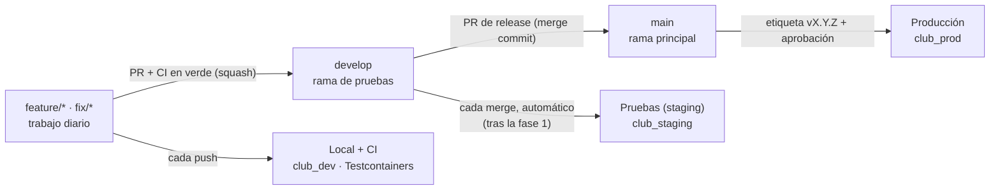

# Reglas técnicas: lenguajes, ramas y entornos

Última revisión: 2026-11-26.

Estas reglas son obligatorias para todo el código del proyecto: cada lenguaje tiene sus convenciones y cada rama tiene su propio entorno y su propia base de datos, sin cruces.

El [documento de pautas](../00-plan/pautas-proyecto.md) define el flujo de trabajo (issues, PRs, Definition of Done), el [plan](../00-plan/plan-proyecto.md) define qué se construye y la [matriz de permisos](../02-requisitos/matriz-permisos.md) define quién puede hacer qué. Este documento define cómo se escribe el código y dónde se ejecuta. Lo que pueda automatizarse (formato, linter, nombres de migraciones) se comprueba en la CI, no a mano.

Cuando una regla de aquí choque con una costumbre del framework, gana la regla; si la regla resulta mala, se cambia con un PR y un ADR, no se ignora.

## Versiones

Se usan versiones con soporte en el momento de crear el repositorio y se fijan de forma exacta. Dependabot propone las actualizaciones y cada subida pasa por un PR con la CI en verde.

| Herramienta | Versión | Dónde se fija |
| --- | --- | --- |
| Java | 25 (LTS) | `java.version` en el `pom.xml` |
| Spring Boot | 4.2.x | `spring-boot-starter-parent` en el `pom.xml` |
| Maven | La del wrapper | `./mvnw`, nunca el Maven instalado en el equipo |
| MySQL | 8.4 | Imagen de Docker Compose y de Testcontainers |
| Angular | 22.x, con SSR | `package.json` |
| Node | 24 LTS | `.nvmrc` y `engines` en `package.json` |
| pnpm | Versión exacta | Campo `packageManager` en `package.json` |

- **Nunca se usa `npm` ni `yarn`:** todo el frontend se instala y se ejecuta con `pnpm`. En el repositorio solo existe `pnpm-lock.yaml`.
- **Tampoco `npx` ni el `ng` global**, porque usan npm por debajo o una versión distinta del CLI: en vez de `npx <paquete>` se usa `pnpm dlx <paquete>` (fuera del proyecto) o `pnpm exec <paquete>` (instalado en el proyecto); en vez de `ng generate` o `ng serve`, `pnpm ng generate` y `pnpm start`, que usan el CLI local. El proyecto se crea con `pnpm dlx @angular/cli@22 new frontend --package-manager=pnpm --ssr`, y `angular.json` lleva `"cli": { "packageManager": "pnpm" }`.
- La CI usa las mismas versiones que el equipo local, leídas de esos ficheros.
- Subir una versión mayor (Spring Boot, Angular, Java, Node) es una tarea con su issue y, si cambia algo de fondo, su ADR.

## Entornos

Hay cuatro entornos y cada uno tiene su rama, su base de datos y su configuración. Ningún entorno comparte base de datos con otro.

| Entorno | Para qué sirve | Rama que lo alimenta | Base de datos | Perfil Spring | Datos |
| --- | --- | --- | --- | --- | --- |
| Local (`dev`) | Programar y probar en tu equipo | Cualquier `feature/*`, `fix/*` | `club_dev` en Docker local | `dev` | Semilla ficticia, se puede borrar cuando quieras |
| Test (`test`) | Tests automáticos en local y en la CI | Cualquier rama, en cada push y PR | Contenedor MySQL efímero (Testcontainers) | `test` | Los crea cada test y desaparecen al terminar |
| Pruebas (`staging`) | Probar lo integrado antes de publicarlo, enseñar demos | `develop` (despliegue automático) | `club_staging` en TiDB Cloud Starter | `staging` | Semilla ficticia + lo que se cree probando; se puede resetear |
| Producción (`prod`) | La web pública | `main` (despliegue al crear la release) | `club_prod` en TiDB Cloud Starter | `prod` | Ficticios para el portfolio, pero se tratan como reales: nunca se borran ni se editan a mano |

**`staging` se despliega al cerrar la fase 1.** Desde el inicio existen `dev`, `test` y `prod`; el perfil `staging` está definido, pero hasta que la fase 1 esté cerrada `develop` solo pasa la CI y las releases se prueban en local con la checklist. Las reglas de abajo que mencionan `staging` se aplican desde ese momento.

Reglas de entornos:

- El código es el mismo en todos los entornos; solo cambia la configuración, que entra por variables de entorno.
- Lo que no ha pasado por pruebas (`staging`) no llega a producción. Cada release se prueba primero en `staging` con la checklist de la release.
- Cada entorno tiene sus propias claves: secreto JWT, credenciales de base de datos, claves de Cloudinary, de Stripe (modo test en `dev` y `staging`) y del servicio de email.
- En `dev` y `staging` los emails no salen a personas reales: van a un buzón de pruebas (Mailpit en local, un sandbox del proveedor en `staging`).
- La web de `staging` muestra una franja visible «Entorno de pruebas» y no se indexa en buscadores (`noindex`).

## Ramas de GitHub y entornos

`main` es la rama principal y equivale a producción; `develop` es la rama de pruebas y equivale a `staging`. El trabajo diario nunca toca ninguna de las dos directamente. El despliegue automático de `develop` en `staging` empieza al cerrar la fase 1.

En GitHub, la rama por defecto es `develop`: es la base de todos los PRs del día a día y así `Closes #<issue>` cierra el issue al fusionar. `main` sigue siendo la rama de producción y solo recibe releases y hotfixes.



Cada rama alimenta un solo entorno; un `hotfix/*` sale de `main`, pasa por la CI y vuelve a `main` y a `develop`.

| Rama | Entorno | Se despliega | Quién escribe en ella |
| --- | --- | --- | --- |
| `main` | Producción | Al publicar una etiqueta `vX.Y.Z` | Solo PR desde `develop` (release) o `hotfix/*` |
| `develop` | Pruebas (`staging`) | En cada merge, automáticamente (tras la fase 1) | Solo PR desde `feature/*`, `fix/*`, `docs/*` |
| `feature/*`, `fix/*`, `docs/*` | Local + CI | Nunca | Tú, con commits pequeños |
| `hotfix/*` | Local + CI, después `staging` | Nunca directamente | Tú; vuelve a `main` y a `develop` |

Protección de ramas en GitHub (*Settings → Rules*), igual para `main` y `develop`, activa desde la fase 0; solo cambia el tipo de merge:

- [ ] Pull request obligatorio antes de fusionar
- [ ] Comprobaciones de la CI obligatorias: `backend-build`, `backend-test`, `frontend-lint`, `frontend-test`
- [ ] La rama debe estar al día con la base antes de fusionar
- [ ] Prohibido `force push` y prohibido borrar la rama
- [ ] En `develop`: historial lineal y solo squash merge; cada `feature/*`, `fix/*` o `docs/*` entra como un único commit
- [ ] En `main`: solo merge commit, sin historial lineal, para que cada release y cada hotfix queden como un commit propio, fácil de etiquetar y de revertir de una vez. Un `hotfix/*` entra en `main` con merge commit y vuelve a `develop` con otro PR (squash)
- [ ] En `main`, además: el despliegue a producción exige aprobación manual (GitHub Environments → *Required reviewers*)

La comprobación `e2e` (Playwright) no se ejecuta en cada PR: es obligatoria solo en el PR de release `develop → main`.

Release, paso a paso: se congela `develop`, se prueba en `staging` con la checklist y los E2E, se abre el PR `develop → main`, se fusiona, se crea la etiqueta y la release con el changelog, y se despliega a producción.

## Bases de datos por entorno

Cada entorno tiene su propia base de datos y su propio usuario de MySQL, y el esquema de todas sale de las mismas migraciones Flyway. La única diferencia entre ellas son los datos.

|  | `club_dev` | Testcontainers | `club_staging` | `club_prod` |
| --- | --- | --- | --- | --- |
| Dónde | Docker Compose local | Contenedor creado por los tests | TiDB Cloud Starter, en su propia instancia | TiDB Cloud Starter, en su propia instancia |
| Usuario de la aplicación | `club_dev_app` | El que crea el contenedor | `club_staging_app` | `club_prod_app` |
| Permisos de la aplicación | Todos sobre su base | Todos | `SELECT, INSERT, UPDATE, DELETE` | `SELECT, INSERT, UPDATE, DELETE` |
| Quién ejecuta migraciones | La app al arrancar | La app al arrancar | Workflow de GitHub Actions (Flyway) con un usuario `*_migrator` | Workflow de GitHub Actions (Flyway) con un usuario `*_migrator` |
| Datos semilla (`db/seed`) | Sí | No, cada test crea los suyos | Sí, solo en el primer despliegue o al resetear | Nunca: solo datos de catálogo (roles, categorías) por migración |
| `flyway.clean` | Permitido | Permitido | Permitido, para resetear | Desactivado (`spring.flyway.clean-disabled=true`) |
| Copia de seguridad | No | No | No hace falta | Automática diaria de TiDB (1 día) + exportación Dumpling cifrada semanal y antes de cada release (30 días) |

Reglas de la base de datos:

1. El esquema solo cambia con una migración Flyway en `backend/src/main/resources/db/migration`. Nunca se crea ni se altera una tabla a mano, en ningún entorno.
2. `spring.jpa.hibernate.ddl-auto=validate` en todos los perfiles. Hibernate comprueba que las entidades encajan con el esquema; nunca lo crea ni lo modifica.
3. Una migración fusionada en `develop` ya no se edita: si tiene un error, se corrige con otra migración nueva.
4. Los datos semilla viven en `db/seed` y solo se cargan en los perfiles `dev` y `staging` (`spring.flyway.locations` distinto por perfil). Son migraciones repetibles con nombre `R__seed_NN_<tema>.sql` (el número fija el orden, porque Flyway las aplica por orden alfabético) y se pueden volver a aplicar sin duplicar filas: `INSERT IGNORE` sobre las claves únicas. El catálogo que necesita producción (las categorías) no es semilla: va en una migración versionada, por ejemplo `V4_1__insert_categories.sql`.
5. Desde tu equipo nunca te conectas a `club_prod` con un usuario que pueda escribir. Para consultar producción se usa un usuario `club_prod_readonly`.
6. Toda migración pasa primero por `club_staging`. Si falla allí, no llega a `main`. Hasta que exista `staging`, pasa por `club_dev` desde cero y por los tests de integración.
7. Copias de `club_prod`: TiDB Cloud Starter hace una copia automática diaria que solo se guarda 1 día (se restaura desde su panel; `BACKUP` y `RESTORE` no están disponibles). Además, un workflow de GitHub Actions exporta la base con Dumpling y el usuario `club_prod_readonly` cada semana y como paso del workflow de release, antes de desplegar; la exportación se cifra con `age` y se guarda como artifact durante 30 días. Una vez por fase se descarga la última, se descifra y se restaura en el MySQL local para comprobar que está completa.
8. El usuario administrador inicial no va en una migración: se crea al arrancar a partir de las variables `ADMIN_EMAIL` y `ADMIN_PASSWORD` si no existe ningún administrador.

**TiDB en `staging` y `prod`.** Las bases de los entornos desplegados viven en TiDB Cloud Starter, que habla el protocolo de MySQL pero no es MySQL idéntico. En local y en los tests se sigue usando MySQL 8.4.

- Antes de la primera migración se activa `tidb_enable_check_constraint` en cada instancia; sin ella, TiDB ignora los `CHECK`.
- En el primer despliegue se comprueba que TiDB Cloud Starter permite activar esa variable. Si no lo permite, los `CHECK` se comprueban solo en Java y se anota en un ADR.
- En `staging` y `prod` las migraciones las ejecuta el workflow de despliegue de GitHub Actions (`./mvnw flyway:migrate` con el usuario `*_migrator`, credenciales en GitHub Environments). Solo si terminan bien, el workflow llama al deploy hook de Render; el auto-deploy de Render está desactivado. El pre-deploy command de Render no existe en el plan gratuito.
- Antes de cada release, las migraciones se ejecutan contra TiDB: en `staging`, o en una instancia de pruebas mientras no exista.
- Si algo de las migraciones no funciona en TiDB, se busca una forma compatible con los dos y se anota en un ADR; nunca se escriben migraciones distintas por entorno.

## Reglas comunes a todos los lenguajes

Todo lo que es código va en inglés: clases, variables, tablas, columnas, rutas de la API y commits. En español solo va lo que lee una persona: documentación, comentarios del código (Javadoc y TSDoc incluidos), textos de la interfaz y mensajes de error que ve el usuario.

Equivalencias entre el dominio en español y el código, que también van al glosario:

| Dominio (español) | Clase Java | Tabla | Ruta API |
| --- | --- | --- | --- |
| Temporada | `Season` | `seasons` | `/seasons` |
| Categoría | `Category` | `categories` | `/categories` |
| Equipo | `Team` | `teams` | `/teams` |
| Persona | `Person` | `people` | `/people` |
| Pertenencia | `TeamMembership` | `team_memberships` | `/teams/{id}/roster` |
| Competición | `Competition` | `competitions` | `/competitions` |
| Jornada | `Matchday` | `matchdays` | `/competitions/{id}/matchdays` |
| Partido | `Match` | `matches` | `/matches` |
| Set | `MatchSet` | `match_sets` | `/matches/{id}/result` |
| Instalación | `Venue` | `venues` | `/venues` |
| Noticia | `NewsArticle` | `news_articles` | `/news` |
| Clasificación | `Standing` | `standings` | `/competitions/{id}/standings` |
| Usuario | `User` | `users` | `/admin/users`, `/me` |
| Rol | `Role` | `roles` | `/admin/users/{id}/roles` |
| Tutela | `Guardianship` | `guardianships` | `/me/dependants` |
| Aviso | `Announcement` | `announcements` | `/announcements` |
| Token de refresco | `RefreshToken` | `refresh_tokens` | `/auth/refresh`, `/auth/logout` |
| Token de cuenta | `AccountToken` | `account_tokens` | `/auth/invitation/accept`, `/auth/password-reset` |
| Convocatoria | `CallUp` | `call_ups` | `/matches/{id}/call-ups` |
| Entrenamiento | `TrainingSession` | `training_sessions` | `/teams/{id}/trainings` |
| Asistencia | `Attendance` | `attendances` | `/trainings/{id}/attendance` |
| Historial de cambios | `AuditLog` | `audit_log` | `/admin/audit-log` |
| Notificación | `Notification` | `notifications` | — (sin ruta propia) |
| Cuota | `MembershipFee` | `membership_fees` | `/fees` |
| Pago | `Payment` | `payments` | `/fees/{id}/payments` |

`Person` es la persona (jugador, entrenador, tutor) y `User` es solo su cuenta de acceso, que es opcional: un menor es una `Person` sin `User`. Pertenencias, tutelas, convocatorias, asistencias y cuotas apuntan a `Person`, nunca a `User`.

La relación también es opcional en el otro sentido: un `User` puede no tener `Person`. Es el caso del administrador inicial, una cuenta técnica creada al arrancar. Una cuenta sin `Person` no puede tener pertenencias, tutelas, convocatorias ni cuotas; si esa persona entra en el club, se vincula su cuenta a su `Person`.

`Set` se llama `MatchSet` para no chocar con `java.util.Set` ni con la palabra reservada `SET` de MySQL; las tablas van en plural, entre otras cosas, porque `MATCH` también es reservada. `audit_log` es la única tabla en singular.

Palabras con un solo significado: «categoría» es solo `Category` (alevín, cadete…) y «aviso» es solo `Announcement`. El tipo de una noticia es `NewsArticle.type` (`MATCH_REPORT`, `EVENT` o `STATEMENT`: crónica, evento o comunicado).

Formato y herramientas (se ejecutan en la CI y en el *pre-commit*):

| Ámbito | Herramienta | Configuración |
| --- | --- | --- |
| Todos los ficheros | EditorConfig | `.editorconfig` en la raíz: UTF-8, saltos de línea LF, 2 espacios, línea final, sin espacios al final |
| Java | Spotless + google-java-format | plugin en el `pom.xml`; `./mvnw verify` falla si hay algo sin formatear |
| Javadoc de los servicios Java | Checkstyle (`MissingJavadocMethod`) | plugin en el `pom.xml`, solo sobre las clases `*Service`; `./mvnw verify` falla si falta |
| TypeScript, HTML, SCSS, JSON | Prettier + ESLint (angular-eslint) | `.prettierrc`, `eslint.config.js` |
| TSDoc de los servicios Angular | `eslint-plugin-jsdoc` (`require-jsdoc`) | en `eslint.config.js`, solo sobre `*.service.ts` y las entradas de los componentes de `shared/` |
| SQL | SQLFluff (dialecto `mysql`) | `.sqlfluff`, solo sobre `db/` |
| Markdown | markdownlint | `.markdownlint.json` |

Límites que se aplican a todo: líneas de 100 caracteres como máximo en el código (en Markdown no se aplica a tablas, enlaces ni bloques de código: regla MD013 con tables: false y code\_blocks: false), funciones de unas 30 líneas (si crece más, se divide), sin código comentado y sin `TODO` sueltos (un `TODO` es un issue con la etiqueta `tech-debt`).

**Comentarios**

1. **Idioma:** los comentarios, el Javadoc y el TSDoc van en español, aunque los nombres del código vayan en inglés.
2. **El porqué, no el qué:** un comentario explica una decisión, una regla de negocio o un caso raro que el código no puede contar por sí solo. Si repite lo que dice el código, sobra: se mejora el nombre de la variable o del método.
3. **Javadoc obligatorio** en las clases y los métodos públicos de los servicios con lógica de negocio (`*Service`): qué hace, qué regla del dominio aplica y qué excepciones lanza (`@throws`). No hace falta en controladores, repositorios, DTOs ni getters.
4. **TSDoc obligatorio** en los métodos públicos de los servicios de Angular (`*.service.ts`) y en las entradas (`input()`) de los componentes de `shared/`.
5. **Reglas del dominio enlazadas:** si el código aplica una regla escrita en `docs/` (por ejemplo, el cálculo de la clasificación), el Javadoc la cita en una línea en lugar de copiarla.
6. **Prohibido:** código comentado, comentarios `TODO` (cada pendiente es un issue con `tech-debt`), cabeceras con autor o fecha (las da Git) y comentarios que solo cierran bloques (`// end if`).
7. **Comprobación automática:** Checkstyle en el backend y `eslint-plugin-jsdoc` en el frontend (tabla de herramientas de arriba); si falta un comentario obligatorio, la CI falla.

```java
/**
 * Registra el resultado set a set de un partido del club y recalcula la clasificación.
 *
 * <p>Un 3-2 da 2 puntos al ganador y 1 al perdedor (ver
 * docs/04-datos/calculo-clasificacion.md).
 *
 * @throws MatchNotFoundException si el partido no existe
 * @throws InvalidSetScoreException si un set no llega a 25 puntos (15 en el quinto) con dos
 *     de diferencia
 */
public MatchResponse registerResult(Long matchId, RegisterResultRequest request) { … }
```

## Java y Spring Boot

Java 25 y Spring Boot 4.2 con Google Java Style, paquetes por funcionalidad y la lógica de negocio siempre en los servicios.

**Estructura**

```
backend/src/main/java/com/<club>/api/
├── common/        Errores, configuración, auditoría, utilidades compartidas
├── security/      JWT, filtros, configuración de Spring Security
├── auth/          Login y administrador inicial
├── users/         Cuentas (User) y su repositorio
├── storage/       ImageStorage y sus implementaciones (local, Cloudinary)
├── mail/          EmailSender y sus implementaciones (Mailpit, Brevo)
├── news/
│   ├── NewsArticle.java              Entidad JPA
│   ├── NewsArticleRepository.java
│   ├── NewsService.java
│   ├── NewsController.java           Lectura pública y gestión, protegida por rol
│   ├── NewsMapper.java               MapStruct
│   └── dto/  NewsResponse, NewsSummaryResponse, CreateNewsRequest…
└── matches/ …
```

Solo la configuración exclusiva del administrador (usuarios, roles e historial) tiene controladores bajo `/api/v1/admin`.

**Nombres**

| Elemento | Convención | Ejemplo |
| --- | --- | --- |
| Clases | `PascalCase`, sustantivo | `StandingService` |
| Métodos y variables | `camelCase`, verbo para métodos | `recalculateStandings()` |
| Constantes | `UPPER_SNAKE_CASE` | `MAX_SETS_PER_MATCH` |
| Paquetes | minúsculas, una palabra | `matches` |
| DTO de entrada | `<Acción><Recurso>Request` | `CreateMatchRequest` |
| DTO de salida | `<Recurso>Response` | `MatchResponse` |
| Excepciones | `<Motivo>Exception` | `MatchNotFoundException` |
| Tests | `<Clase>Test` (unitario), `<Clase>IT` (integración) | `StandingServiceTest` |
| Métodos de test | `should<Resultado>When<Condición>` | `shouldGiveTwoPointsWhenMatchEndsThreeTwo` |

**Reglas**

1. Los DTOs son `record` y llevan las anotaciones de Bean Validation (`@NotBlank`, `@Size`…). Las entidades JPA nunca salen del servicio.
2. Inyección por constructor con campos `private final`. Nunca `@Autowired` sobre un campo.
3. Los controladores solo reciben, validan (`@Valid`) y delegan. Ni lógica de negocio ni acceso a repositorios.
4. `@Transactional` en los métodos del servicio, no en controladores ni repositorios; `readOnly = true` en las lecturas.
5. Errores: excepciones propias que un `@RestControllerAdvice` traduce a `ProblemDetail`. Nunca se devuelve `null` para decir «no encontrado»: se usa `Optional` en repositorios y una excepción en el servicio.
6. Autorización con `@PreAuthorize` en el servicio o el controlador, siguiendo la matriz de permisos, y la comprobación de propiedad («¿es el entrenador de este equipo?», «¿es el tutor de este menor?») en el servicio.
7. Fechas con `java.time`: `Instant` para momentos exactos (guardados en UTC), `LocalDate` para fechas sin hora. Dinero con `BigDecimal`, nunca `double`.
8. Relaciones JPA en `FetchType.LAZY` y consultas con `@EntityGraph` o `JOIN FETCH` cuando haga falta la relación. Nada de `CascadeType.ALL` por defecto.
9. Logs con SLF4J: `info` para eventos de negocio, `warn` para lo recuperable, `error` para fallos. Nunca se registran contraseñas, tokens ni datos personales.
10. Lombok solo para `@Getter`, `@Setter` y `@NoArgsConstructor` en entidades. Nunca `@Data` en entidades (rompe `equals` y `hashCode` con las relaciones).
11. Las entidades de negocio heredan de la clase base auditable con `createdAt`, `updatedAt`, `createdBy` y `updatedBy`, rellenados por la auditoría de Spring Data (`@EnableJpaAuditing`), nunca a mano.
12. Excepciones a la regla anterior: `UserRole` (entidad propia de la tabla `user_roles`) hereda de `CreationAuditable`, que solo tiene `createdAt` y `createdBy`. `AuditLog`, `RefreshToken` y `AccountToken` no heredan de ninguna clase base auditable: tienen sus propias fechas.
13. Las imágenes se guardan siempre a través de la interfaz `ImageStorage`; la implementación (disco local o Cloudinary) la elige el perfil. La base de datos solo guarda la URL.
14. Los emails se envían siempre a través de la interfaz `EmailSender`; la implementación la elige el perfil: SMTP contra Mailpit en `dev` y la API HTTP de Brevo (puerto 443) en `staging` y `prod`, porque Render gratuito bloquea los puertos SMTP 25, 465 y 587.
15. El cuerpo de las noticias se guarda en Markdown. El backend lo convierte a HTML y lo sanea con una lista blanca de etiquetas (OWASP Java HTML Sanitizer) antes de devolverlo; el frontend nunca sanea por su cuenta ni confía en HTML que no venga de ahí.
16. Los tests de integración usan siempre MySQL real con Testcontainers. No se usa H2. Cómo se escriben y se ejecutan todos los tests: [guía de tests](guia-tests.md).
17. La documentación de la API se genera desde el código con springdoc (`/swagger-ui`, JSON en `/v3/api-docs`). Cada controlador lleva `@Tag` con la etiqueta del contrato (`docs/05-api/openapi-fase-1.yaml`) y cada operación `@Operation(summary = …)` con su resumen. El código de éxito, los errores y el candado del access token los añade `OpenApiConfig` según la tabla «Métodos y respuestas» y el `@PreAuthorize`; solo las rutas que no siguen la tabla (autenticación) declaran sus respuestas con `@ApiResponse`. `OpenApiIT` falla si lo generado se separa del contrato. En `prod`, `/swagger-ui` es solo de lectura (sin «Try it out»).
18. Borrado lógico (`deleted_at`): el repositorio filtra las filas borradas en sus consultas (`findByIdAndDeletedAtIsNull`, `… WHERE p.deletedAt IS NULL`). No se usa `@SQLRestriction` en la entidad: Hibernate también la aplica al cargarla desde otra entidad, y las plantillas de temporadas pasadas perderían a las personas borradas. Otras áreas reaccionan al borrado con un evento (`PersonDeletedEvent`), sin que el paquete que borra dependa de ellas.

**Autenticación**

1. Contraseñas con BCrypt. El access token JWT dura 15 minutos y lleva el id del usuario (`sub`), su email (para mostrar quién tiene la sesión tras recargar) y sus roles; nada más.
2. El refresh token viaja en una cookie `HttpOnly`, `Secure`, `SameSite=Strict` y con `Path=/api/v1/auth`, sin atributo Domain, para que solo valga en el dominio del frontend. Nunca va en el cuerpo de la respuesta ni es accesible desde JavaScript.
3. Los refresh tokens se guardan con hash (SHA-256) en `refresh_tokens` y rotan en cada uso. Si llega uno ya usado, se revocan todos los del usuario. La sesión es deslizante: cada refresco alarga la caducidad 2 horas, y la sesión termina tras 2 horas sin refrescos o, como máximo, 7 días después del login.
4. Los tokens de invitación y de recuperación se guardan con hash en `account_tokens`, son de un solo uso y caducan (invitación: 7 días; recuperación: 1 hora).
5. Tras 5 intentos de login fallidos seguidos para un mismo email desde la misma IP, esa combinación se bloquea 15 minutos; desde otra IP se puede seguir entrando. Además, `/api/v1/auth/**` admite como mucho 20 peticiones por minuto por IP (Bucket4j). Los contadores viven en memoria (Caffeine), no en la base de datos. Desde la fase 2, el usuario recibe un email avisando de los intentos fallidos.
6. Las respuestas de login y de recuperación no revelan si un email existe ni si está bloqueado: un login fallido devuelve siempre 401 con el mismo mensaje.
7. CORS desactivado: el navegador solo habla con el frontend, que reenvía /api a la API (ver SSR, regla 6), así que la API no admite ningún origen externo. La API solo se fía de X-Forwarded-For cuando viene del proxy (server.forward-headers-strategy), para que el bloqueo de login y los logs usen la IP real. Nunca `*`.
8. Login, refresco y cierre de sesión existen desde la fase 1. Mientras hay actividad (teclado o clic desde el último token), el frontend pide un access token nuevo un minuto antes de que caduque el actual; sin actividad lo deja caducar, y la siguiente petición lo renueva con la cookie si aún no han pasado 2 horas. Las renovaciones de una pestaña van de una en una. El editor de noticias guarda un borrador en el navegador (sin datos de sesión) para no perder trabajo si la sesión termina.

## SQL y MySQL

Tablas en plural y `snake_case`, InnoDB con `utf8mb4`, y cada cambio de esquema en una migración con nombre normalizado.

**Nombres**

| Elemento | Convención | Ejemplo |
| --- | --- | --- |
| Tabla | plural, `snake_case` | `team_memberships` |
| Columna | `snake_case` singular | `starts_at` |
| Clave primaria | `id BIGINT UNSIGNED AUTO_INCREMENT` | `id` |
| Clave foránea | `<tabla_singular>_id` | `team_id` |
| Booleano | adjetivo o participio sin prefijo, `BOOLEAN`; mismo nombre en Java y JSON | `featured` |
| Fecha y hora | sufijo `_at`, `DATETIME(6)` en UTC | `published_at` |
| Fecha sin hora | sufijo `_date`, `DATE` | `birth_date` |
| Índice | `idx_<tabla>_<columnas>` | `idx_matches_starts_at` |
| Único | `uk_<tabla>_<columnas>` | `uk_users_email` |
| FK | `fk_<tabla>_<tabla_referida>` | `fk_matches_venues` |
| Check | `ck_<tabla>_<regla>` | `ck_match_sets_points` |
| Migración | `V<n>__<verbo>_<objeto>.sql` | `V7__create_match_sets.sql` |

**Reglas**

1. Todas las tablas: `ENGINE=InnoDB`, `CHARSET utf8mb4`, `COLLATE utf8mb4_0900_ai_ci`, y las columnas `created_at`, `updated_at`, `created_by` y `updated_by` (las dos últimas, `BIGINT UNSIGNED NULL` hacia `users`; nulas cuando el cambio lo hace el sistema).
2. Excepciones a las columnas de auditoría: `user_roles` solo lleva `created_at` y `created_by`, porque sus filas se insertan y se borran, nunca se actualizan. `audit_log` (`changed_at`, `changed_by`), `refresh_tokens` y `account_tokens` no las llevan: tienen sus propias columnas de fecha. `flyway_schema_history` la crea y gestiona Flyway y nunca se modifica.
3. Estados y tipos como `VARCHAR(30)` con un `CHECK` de valores permitidos, no con `ENUM` de MySQL (añadir un valor a un `ENUM` obliga a alterar la tabla).
4. Dinero en `DECIMAL(10,2)`. Nunca `FLOAT` ni `DOUBLE`.
5. Toda clave foránea lleva su índice y una regla `ON DELETE` explícita (`RESTRICT` por defecto; `CASCADE` solo en hijos que no tienen sentido sin el padre, como `match_sets`).
6. Las reglas que deben cumplirse siempre se ponen también en la base de datos: `NOT NULL`, `UNIQUE` y `CHECK`, no solo en Java.
7. Una migración hace un solo cambio lógico, en palabras clave SQL en mayúsculas, y nunca mezcla esquema y datos semilla.
8. Prohibido `SELECT *` en consultas escritas a mano: se nombran las columnas.
9. Las consultas nativas (`@Query(nativeQuery = true)`) solo cuando JPQL no llegue, siempre con parámetros, nunca concatenando texto.
10. Antes de fusionar una migración: ejecutarla desde cero en `club_dev` (`flyway clean` + `migrate`) y comprobar que los tests de integración pasan.
11. Borrado lógico con una columna `deleted_at` solo en `people`, `users`, `news_articles` y `membership_fees`; las consultas normales las excluyen. El resto de tablas se borra de verdad.
12. El borrado de una persona por RGPD la anonimiza (nombre, contacto y foto) y conserva sus resultados, asistencias y pagos.
13. `audit_log` solo admite inserciones: nunca se actualiza ni se borra una fila. Guarda el valor anterior y el nuevo en columnas `JSON`.

## TypeScript y Angular

Angular 22 con renderizado en servidor (SSR), TypeScript en modo estricto, componentes *standalone* y una carpeta por funcionalidad, igual que en el backend.

**Estructura**

```
frontend/src/app/
├── core/        Interceptores (JWT, errores), guards, servicios únicos, layout
├── shared/      Componentes, pipes y directivas reutilizables
├── features/
│   ├── news/    páginas, componentes, news.service.ts, news.models.ts, news.routes.ts
│   ├── matches/
│   └── admin/
├── app.routes.ts
└── app.routes.server.ts   Modo de renderizado de cada ruta
```

**Nombres**

| Elemento | Convención | Ejemplo |
| --- | --- | --- |
| Ficheros | `kebab-case`, componentes sin sufijo, como el CLI; servicios con sufijo .service.ts (configurado en angular.json) y modelos en .models.ts | `news-list.ts`, news.service.ts |
| Componentes, servicios, interfaces | `PascalCase` | `NewsList`, `NewsService`, `NewsResponse` |
| Selector de componente | prefijo del club + `kebab-case` | `cv-news-list` |
| Variables y métodos | `camelCase` | `loadNextPage()` |
| Observables | sufijo `$` | `matches$` |
| Constantes globales | `UPPER_SNAKE_CASE` | `API_BASE_URL` |

**Reglas**

1. `strict: true` en `tsconfig.json` y prohibido `any` (regla de ESLint en error). Si un tipo no se conoce, `unknown` y se comprueba.
2. Los modelos de la API son `interface` en `<funcionalidad>.models.ts` y copian exactamente los DTOs del backend.
3. Las llamadas HTTP solo se hacen desde servicios; los componentes nunca usan `HttpClient` directamente.
4. En el navegador la API se llama siempre con la ruta relativa /api/v1; en el servidor SSR, con la URL pública de la API, de la variable API\_URL (los servicios gratuitos de Render no reciben tráfico de red privada). Nunca se escribe `http://localhost:8080` en el código.
5. El access token se guarda solo en memoria (un servicio), nunca en `localStorage` ni `sessionStorage`, y se añade en un interceptor. Al cargar la aplicación en el navegador se pide uno nuevo con la cookie de refresco.
6. Los permisos por rol se comprueban con guards. Ocultar un botón no es seguridad: el backend vuelve a comprobarlo.
7. Rutas con carga diferida (*lazy loading*) por funcionalidad.
8. Formularios reactivos con validación tipada; los mensajes de error se muestran junto al campo.
9. Estado del componente con *signals*; RxJS para flujos asíncronos (HTTP, búsquedas). Suscripciones con `async` pipe o `takeUntilDestroyed`, nunca sin cerrar.
10. Cada pantalla con datos tiene tres estados visibles: cargando, vacío y error.
11. Los textos de la interfaz en español y en las plantillas, no en el código TypeScript.

**SSR**

1. Las páginas públicas (inicio, noticias, equipos, calendario, clasificación, club) se renderizan en el servidor. Las áreas privadas y el panel de administración se renderizan solo en el navegador.
2. Prohibido usar `window`, `document`, `localStorage` o `navigator` directamente: el código que solo vale en el navegador va en `afterNextRender` o tras comprobar `isPlatformBrowser`.
3. Cada página pública pone su título y su descripción; el detalle de noticia añade las etiquetas Open Graph (título, resumen, imagen) con los servicios `Title` y `Meta`.
4. El servidor nunca hace peticiones autenticadas: en SSR solo se llama a endpoints públicos.
5. El frontend se despliega como un proceso Node, no como ficheros estáticos.
6. El servidor Node del SSR hace de proxy: reenvía `/api/**` a la API con `X-Forwarded-For` y el mismo tamaño máximo de cuerpo que la API (subida de imágenes). En local lo hace el `proxy.conf.json` del servidor de desarrollo. Así el navegador nunca llama a otro dominio: la cookie de refresco es de primera parte y no hace falta CORS. Motivo: `onrender.com` está en la Public Suffix List, y dos subdominios suyos cuentan como sitios distintos (ADR-004).
7. Un único build para todos los entornos: no hay ficheros `environment.*.ts` por entorno. El servidor SSR lee al arrancar `API_URL` y `APP_ENV` (`dev`, `staging` o `prod`) y pasa al navegador lo que necesite (la franja de pruebas, el `noindex`) con `TransferState`.

**Tests**

1. Tests unitarios y de componentes con Vitest: `pnpm test`.
2. Tests de extremo a extremo con Playwright en `frontend/e2e/`, solo para los flujos críticos: login, publicar una noticia, introducir un resultado y ver la clasificación, responder una convocatoria.
3. Los E2E se ejecutan contra el entorno local completo (Docker Compose) y en la CI del PR de release.
4. El detalle (estructura, ejemplos, comandos, smoke y rendimiento) está en la [guía de tests](guia-tests.md).

## HTML y SCSS

HTML semántico y accesible, estilos de móvil hacia escritorio y colores y medidas siempre desde variables.

1. Etiquetas con significado: `header`, `nav`, `main`, `article`, `section`, `footer`; un único `h1` por página y títulos sin saltar niveles.
2. Un `button` para acciones y un enlace (`a` o `routerLink`) para navegar. Nunca un `div` con `(click)`.
3. Toda imagen lleva `alt` (vacío si es decorativa) y todo campo de formulario su `label`.
4. Los colores, tipografías, espacios y puntos de corte salen de variables en `src/styles/_tokens.scss`. Los colores son los de la paleta Atlántico y arena ([paleta-colores.md](../02-requisitos/paleta-colores.md)), con sus nombres `--color-*`. Ningún color escrito a mano en un componente.
5. Se respetan las reglas de contraste de la paleta: el latón nunca como texto o enlace sobre arena o blanco; sobre azul petróleo, texto en arena.
6. Estilos por componente (encapsulados por Angular); los globales solo en `src/styles/`. Clases en `kebab-case` con BEM cuando haya elementos internos: `match-card__score--winner`.
7. Media queries con `min-width` (móvil primero) y solo con los puntos de corte de las variables.
8. Prohibido `!important`, los estilos en línea y los selectores por `id`.
9. Contraste mínimo AA (4,5:1 en texto normal) y todo usable con teclado, con el foco visible.
10. El HTML de una noticia solo se inserta con `[innerHTML]` cuando viene ya saneado del backend; nunca se usa `bypassSecurityTrustHtml`.

## API REST y JSON

Todas las rutas cuelgan de `/api/v1`, con recursos en plural y en inglés, JSON en `camelCase` y fechas en ISO 8601.

**Rutas**

- Recursos en plural y `kebab-case`: `/api/v1/matches`, `/api/v1/matches/{id}/call-ups`.
- Sin verbos en la ruta; la acción la da el método. Excepción: acciones que no son CRUD, como subrecurso con nombre (`POST /api/v1/matches/{id}/result`).
- **Recursos** en `/api/v1/...`: la lectura pública y la gestión comparten ruta. Quién puede escribir lo decide el rol y la propiedad, según la matriz de permisos (`POST /api/v1/news` para comunicación o admin, `GET /api/v1/teams/{id}/roster` para el entrenador de ese equipo).
- **Usuario autenticado** en `/api/v1/me/...`: lo propio de quien tiene la sesión.
- **Administración** en `/api/v1/admin/...`: solo configuración que únicamente toca el administrador (usuarios, roles e historial de cambios). Temporadas, categorías e instalaciones son recursos normales: lectura pública y gestión solo del administrador.
- No hay zonas por rol (`/coach`, `/treasurer`…) y nadie que no sea administrador entra en `/admin`.
- Parámetros de consulta en `camelCase`: `?teamId=3&from=2026-11-01`.

**Métodos y respuestas**

| Operación | Método | Éxito | Errores habituales |
| --- | --- | --- | --- |
| Listar | `GET /recursos` | 200 + página | 400 filtros inválidos |
| Obtener uno | `GET /recursos/{id}` | 200 | 404 |
| Crear | `POST /recursos` | 201 + cabecera `Location` | 400 validación, 409 duplicado |
| Sustituir | `PUT /recursos/{id}` | 200 | 400, 404, 409 |
| Modificar en parte | `PATCH /recursos/{id}` | 200 | 400, 404 |
| Borrar | `DELETE /recursos/{id}` | 204 | 404, 409 si tiene dependencias |
| Sin sesión o sin permiso | cualquiera | — | 401 sin token o caducado, 403 sin permiso, 429 demasiadas peticiones |

**Formato**

- Paginación con `?page=0&size=20&sort=publishedAt,desc`; tamaño máximo 100. La respuesta trae `content`, `page`, `size`, `totalElements` y `totalPages`.
- Fechas y horas en ISO 8601 con zona: `2026-11-03T18:30:00Z`. Fechas sin hora: `2026-11-03`. El frontend las convierte a la hora local.
- Los errores siguen RFC 7807 (`application/problem+json`) con `type`, `title`, `status`, `detail` y, en errores de validación, `errors` por campo.
- Nunca se devuelven contraseñas, tokens ni IDs internos que no se usen.
- Las respuestas públicas muestran siempre el nombre y la inicial del apellido, nunca los apellidos completos; la foto solo se incluye con consentimiento de imagen.
- Un cambio incompatible en la API crea `/api/v2`; no se rompe `/api/v1`.

## Configuración, secretos y Docker

Un fichero de configuración por perfil y todos los valores sensibles en variables de entorno.

```
backend/src/main/resources/
├── application.yml           Común a todos los entornos, sin secretos
├── application-dev.yml       Docker local, logs detallados, seeds activados, imágenes en disco
├── application-test.yml      Testcontainers
├── application-staging.yml   Seeds activados, logs info, Cloudinary
└── application-prod.yml      clean-disabled, logs warn, Swagger solo lectura, Cloudinary
```

- Variables de entorno en `UPPER_SNAKE_CASE` con prefijo de servicio (más APP\_ENV, que indica el entorno en el frontend): `DB_URL`, `DB_USER`, `DB_PASSWORD`, `JWT_SECRET`, `ADMIN_EMAIL`, `ADMIN_PASSWORD`, `API_URL`, `NG_ALLOWED_HOSTS`, `TRUST_PROXY`, `CLOUDINARY_URL`, `MAIL_API_KEY`, `SENTRY_DSN`, `STRIPE_SECRET_KEY`, `STRIPE_WEBHOOK_SECRET`.
- En el repositorio solo va `.env.example` con todas las claves y sin valores. El `.env` real está en `.gitignore`.
- Los secretos de `staging` y `prod` se guardan en el panel del hosting y en *GitHub Environments*, nunca en un fichero.
- `docker-compose.yml` levanta lo necesario para `dev`: MySQL 8.4 con `club_dev` y Mailpit para ver los emails. Fija la versión de cada imagen (`mysql:8.4`, nunca `latest`).
- Los datos de MySQL en local van en un volumen con nombre; `docker compose down -v` es la forma de empezar de cero.
- El perfil activo se elige con `SPRING_PROFILES_ACTIVE`; si no se indica, arranca `dev`. Producción nunca arranca con el perfil por defecto.

**Monitorización**

- Actuator expone solo `/actuator/health`, sin detalles para quien no esté autenticado. El resto de endpoints de Actuator están desactivados.
- Un monitor externo vigila `prod` consultando la página de inicio del frontend, que despierta los dos servicios. Tiene 120 s de tiempo de espera y avisa por email solo tras 2 fallos seguidos, para no dar falsas alarmas por el arranque en frío.
- Sentry (fase 5) recibe los errores de backend y frontend de `staging` y `prod`, sin datos personales en los eventos. En `dev` y `test` está desactivado.

**Hosting**

- La API (imagen Docker) y el frontend (proceso Node con SSR) se despliegan en Render, en el plan gratuito, con el subdominio que da Render y su HTTPS.
- Los servicios gratuitos se duermen a los 15 minutos sin visitas y tardan cerca de 1 minuto en despertar; si están dormidos los dos, la primera visita puede tardar hasta 2 minutos. Para evitarlo, al arrancar el servidor SSR lanza una petición a /actuator/health de la API sin esperar respuesta, y los dos despiertan a la vez. Las 750 horas gratuitas al mes se reparten entre todos los servicios de la cuenta.
- Los servicios tienen 512 MB de RAM, y si se pasan Render reinicia el proceso sin error de Java. La JVM arranca con `-XX:MaxRAMPercentage=60 -XX:+UseSerialGC -XX:ReservedCodeCacheSize=64m -Xss512k` (heap de unos 300 MB y el resto para metaspace, código y pilas). Además, `spring.threads.virtual.enabled=true` y un pool de Hikari de 5 conexiones. Son valores de partida: tras el primer despliegue se mide el consumo y, si pasa del 80 % (unos 410 MB), se ajustan.
- El monitor externo comprueba prod como mucho una vez por hora y solo en ese entorno: comprobaciones más frecuentes la mantendrían siempre despierta y agotarían las horas gratuitas.
- Las bases de datos de `staging` y `prod` son dos instancias distintas de TiDB Cloud Starter, en plan gratuito con límite de gasto 0.

## Markdown y documentación

La documentación se escribe en español, en Markdown, y se revisa en los PRs como el código.

- Nombres de fichero en `kebab-case` y con número si el orden importa: `01-vision.md`, `adr/003-person-user-split.md`.
- Un solo `#` por fichero (el título) y debajo la fecha de última revisión.
- Los bloques de código indican siempre el lenguaje (`java`, `sql`, `mermaid`).
- Enlaces relativos entre documentos del repositorio, nunca a una rama concreta en GitHub.
- Nada de capturas de texto o de código: se pega como texto. Las imágenes, en `docs/assets/`.

## Decisiones

- [x] **Nombres en inglés en código y API.** Decidido el 3 de noviembre de 2026.
- [x] **Maven** para el backend. Decidido el 3 de noviembre de 2026: Spotless y JaCoCo se configuran en el `pom.xml` y la CI ejecuta `./mvnw verify`.
- [x] **Entorno de pruebas (`staging`).** Decidido el 10 de noviembre de 2026: se despliega al cerrar la fase 1; hasta entonces `develop` solo pasa la CI.
- [x] **Versiones.** Decidido el 10 de noviembre de 2026: Java 25, Spring Boot 4.1, Angular 22 con SSR, Node 24 LTS y pnpm.
- [x] **Zonas de la API.** Decidido el 10 de noviembre de 2026: recursos, `/me` y `/admin` solo para configuración.
- [x] **Autenticación.** Decidido el 10 de noviembre de 2026: refresh en cookie httpOnly con rotación, access token en memoria, `account_tokens` y bloqueo tras 5 fallos.
- [x] **Auditoría.** Decidido el 10 de noviembre de 2026: `created_by`/`updated_by`, borrado lógico selectivo y `audit_log` en resultados y cuotas.
- [x] **Paleta de colores.** Decidida el 10 de noviembre de 2026: Atlántico y arena.
- [x] **Hosting de `prod` y `staging`:** Decidido el 10 de noviembre de 2026: Render para la API y el frontend, y TiDB Cloud Starter con una instancia propia para cada base, `club_staging` y `club_prod`; todo en planes gratuitos, sin tarjeta y con el subdominio de Render.
- [x] **Proxy de la API en el servidor SSR.** Decidido el 12 de noviembre de 2026: el navegador solo habla con el frontend, que reenvía `/api` a la API; cookie de refresco sin `Domain` y CORS desactivado (ADR-004).
- [x] **Tipo de merge.** Decidido el 12 de noviembre de 2026: squash merge con historial lineal en `develop` y merge commit en `main`.
- [x] **Sesión deslizante.** Decidido el 12 de noviembre de 2026: refresh token desde la fase 1; la sesión termina tras 2 horas sin actividad o, como máximo, 7 días después del login.
- [x] **Proveedor de email.** Decidido el 12 de noviembre de 2026: Brevo, desde la fase 2 (invitación y recuperación de contraseña). En `dev` se usa Mailpit y en `staging`, el sandbox de Brevo. En los entornos desplegados se usa la API HTTP de Brevo, no SMTP.
- [x] **Migraciones en los entornos desplegados.** Decidido el 12 de noviembre de 2026: las ejecuta GitHub Actions con Flyway y el usuario `*_migrator` antes de llamar al deploy hook de Render.
- [x] **Límite de intentos de login.** Decidido el 12 de noviembre de 2026: bloqueo por email + IP y límite por IP, contadores en memoria y siempre 401 genérico (sin 423), para no revelar emails ni permitir bloquear al administrador.
- [x] **Comentarios del código.** Decidido el 16 de noviembre de 2026: en español, explicando el porqué; Javadoc y TSDoc obligatorios en los servicios, comprobados en la CI con Checkstyle y `eslint-plugin-jsdoc`.
- [x] **Smoke y rendimiento.** Decidido el 22 de noviembre de 2026: smoke con `curl` en GitHub Actions después de cada despliegue, y rendimiento con k6 solo contra `staging`, a mano antes de cada release; detalle en la [guía de tests](guia-tests.md).
- [x] **Rama por defecto en GitHub.** Decidido el 16 de noviembre de 2026: `develop`, porque `Closes #<issue>` solo cierra issues al fusionar en la rama por defecto y todos los PRs del día a día van a `develop`.
- [x] **Spring Boot 4.2.** Decidido el 23 de noviembre de 2026: se sube de 4.1.2 a 4.2.0 (PR #36 de Dependabot) al ser ya estable, antes de empezar el código de negocio.
- [ ] **Prefijo de los selectores Angular** (`cv-` es provisional; el nombre del club, Los Chicharros V.C., también lo es).
